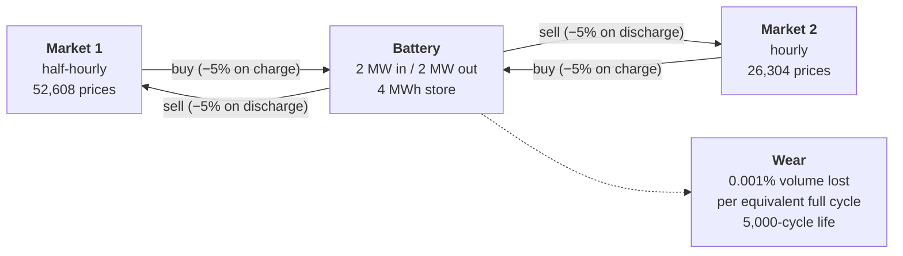
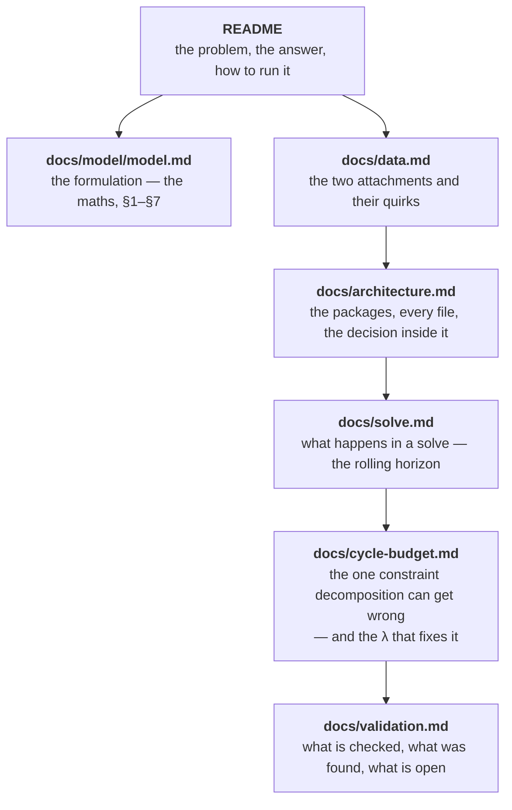

# Battery dispatch model

**Aurora second-round technical exercise.** A 2 MW / 4 MWh battery, two
wholesale electricity markets at different settlement resolutions, three years
of half-hourly prices. The question: what should the battery do, and what is
that worth?

**£207,365** of trading profit over 2018–2020, using **3,443 of the battery's
5,000 cycles** — from a mixed-integer linear program solved as 1,096 rolling
daily windows.

| | |
| --- | --- |
| **Profit, 2018–2020** | £207,365 |
| **Cycles used** | 3,443 of 5,000 |
| **Periods dispatched** | 52,608 half hours |
| **MILPs solved per run** | 1,096 |
| **Tests** | 37, green in ~6 s |
| **Source** | 1,137 lines under `src/` |

## The problem in one picture

The battery buys and sells in two markets. Market 1 settles every half hour;
Market 2 settles hourly, so anything committed to it is committed for the whole
hour. Energy is lost on the way in and on the way out, and every MWh pushed
through wears the asset out a little.



Three consequences drive everything else:

- **A round trip keeps only 90.25%** of what it buys (0.95 × 0.95). A spread has
  to beat ~11% before a trade is worth making at all.
- **Charging and discharging must be mutually exclusive.** The two markets
  diverge, so without a binary forbidding it the "battery" would simply buy in
  one and sell into the other in the same instant — an arbitrage machine, not a
  store.
- **Market 2's decisions are held flat across each hour**, imposed on the
  decision variables rather than on the prices, because that is what committing
  capacity to an hourly product means.

The result is a MILP on a common half-hourly grid, solved a day at a time with a
day of foresight, because 52,608 periods each carrying a binary is not one
tractable program.

## Running it

The project uses [uv](https://docs.astral.sh/uv/). Python 3.12 is pinned in
`.python-version` and installed by uv if missing.

```bash
uv sync --all-groups            # create .venv, install runtime + dev deps

uv run battery-case inputs      # load both spreadsheets, print spec + data quality
uv run battery-case dispatch    # solve all three years (a few minutes)
```

`dispatch` writes the half-hourly schedule to `data/results/` and prints the
headline figures. Restrict it for a quick look:

```bash
uv run battery-case dispatch --start 2018-01-01 --end 2018-01-31
```

| Flag | Default | What it changes |
| --- | --- | --- |
| `--start` / `--end` | all data | Horizon, trimmed on whole hours |
| `--commit-days` | `1` | How much of each solved window is kept |
| `--lookahead-days` | `1` | Foresight beyond the committed part, then discarded |
| `--cycle-price` | `0.0` | £ charged per equivalent full cycle used |
| `--out` | `data/results/dispatch_schedule.csv` | `.csv` or `.parquet` |

Development:

```bash
uv run pytest             # 49 tests, ~22 s
uv run mypy               # strict
uv run ruff check . --fix
uv run ruff format .
make preview              # render docs/model/model.md to HTML and open it
```

## Where to read what



| Document | Read it for |
| --- | --- |
| [`docs/model/model.md`](docs/model/model.md) | The formulation: objective, constraints, assumptions, numbered §1–§7. Every module cites it. |
| [`docs/data.md`](docs/data.md) | What the two spreadsheets contain, the clock-change artefacts, and why the loader reports rather than repairs. |
| [`docs/architecture.md`](docs/architecture.md) | How the code is filed, the dependency rule, every class with the reason it exists, and why the constraints are separate blocks. |
| [`docs/solve.md`](docs/solve.md) | Why the horizon is decomposed, what one window does, and the evidence that a day of foresight suffices. |
| [`docs/cycle-budget.md`](docs/cycle-budget.md) | The global cycle cap, the bug decomposing it exposed, pricing cycles instead of splitting them, and how λ is found by bisection. |
| [`docs/validation.md`](docs/validation.md) | The 49 tests, two bugs found by checking rather than thinking, and the questions still open. |

## Layout

```
src/battery_case/   the package — see docs/architecture.md
tests/              49 tests — see docs/validation.md
data/raw/           the two spreadsheets supplied with the exercise
data/results/       model outputs
docs/brief/         the exercise brief, as supplied
docs/model/         model.md — the formulation (renders on GitHub)
notebooks/          exploratory analysis
Makefile            render targets for the model document
```

---

Figures come from `data/results/dispatch_schedule.csv`, reproduced identically
across two independent full-horizon runs.
