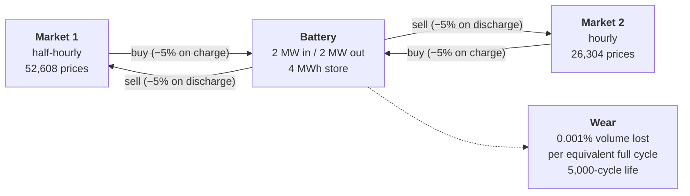
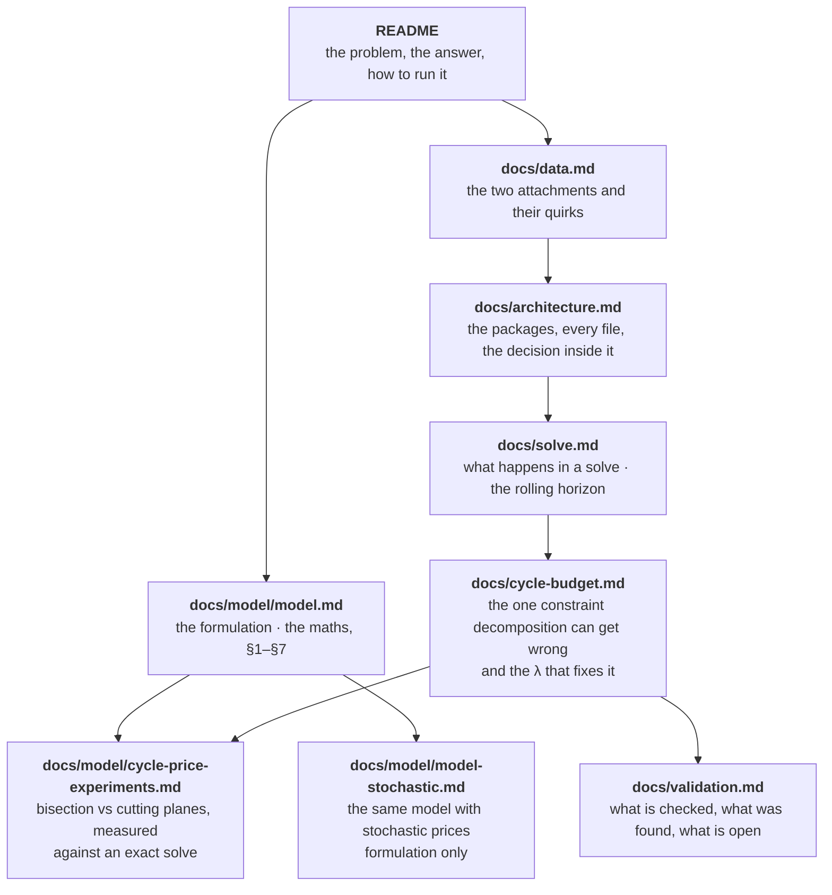

# Battery dispatch model
## Introduction

The repository contains a model for battery's deterministic economic dispacth (perfect information). The model has the following features:

1. §4.1 Storage bounds
2. §4.2 Energy balance with efficiency: Charge loss (5%) and discharge loss (5%)
3. §4.3 Complementarity + charge/discharge rate limits. One binary forbids simultaneous charge/discharge.
4. §4.4 Battery maximum capacity (headroom/stock).
5. §4.5 Market 2 hourly commitment and Market 1 half-hourly commitment. Interacts with §4.3: the battery cannot charge in one half hour and sell into Market 2 in the other half of the same hour.
6. §4.6 Cycle accounting and life cap.
7. §4.7 Battery Degradation.

The approach is a single mixed-integer linear program: half-hourly charge and discharge in each market as the decision variables, round-trip losses and the hourly commitment of Market 2 as constraints, and arbitrage profit net of cycle wear as the objective. 

One program over all 52,608 periods is not tractable, so **the horizon is decomposed** into flexible windows (input parameter), e.g. 1,096 daily windows. Each window is solved with a foresight and committed decision, more details in the modelling document. 

There are two decomposition implementations: a cutting-plane algorithm and a bissection (grid-search).

The model lives in `src/battery_case/`, the formulation it implements is written out section by
section in `docs/model/model.md`, and every number quoted in the documents comes from a committed run. 

## Index

| Section | What it covers |
| --- | --- |
| [The problem in one picture](#the-problem-in-one-picture) | The two markets, the battery, the wear, and the three consequences that shape the model |
| [Running it](#running-it) | Install with uv, the two commands, every flag, the pricer scripts, the dev loop |
| [Where to read what](#where-to-read-what) | The documents, in reading order, with what each one answers |
| [Layout](#layout) | What lives in each directory |

## The problem in one picture

The battery buys and sells in two markets. Market 1 settles every half hour; Market 2 settles hourly, so anything committed to it is committed for the whole hour. Energy is lost on the way in and on the way out, and every MWh pushed through wears the asset out a little.



Three consequences shape the rest:

- **A round trip keeps only 90.25%** of what it buys (0.95 × 0.95), so a spread
  has to beat about 11% before a trade is worth making.
- **Charging and discharging must be mutually exclusive.** The two markets
  diverge, so without a binary forbidding it the battery would buy in one and
  sell into the other in the same instant, wheeling energy it never stores.
- **Market 2's decisions are held flat across each hour**, imposed on the
  decision variables rather than on the prices, because that is what committing
  capacity to an hourly product means.

The result is a MILP on a common half-hourly grid, solved a window(e.g. day) at a time with another window (e.g. day) of foresight. 52,608 periods each carrying a binary is not one tractable
program.

## Running it

The project uses [uv](https://docs.astral.sh/uv/). Python 3.12 is pinned in
`.python-version` and installed by uv if missing.

```bash
uv sync --all-groups            # create .venv, install runtime + dev deps

uv run battery-case inputs      # load both spreadsheets, print spec + data quality
uv run battery-case dispatch    # solve all three years (a few minutes)
```

`dispatch` writes the half-hourly schedule to `data/results/` and prints the headline figures. Restrict it for a quick look:

```bash
uv run battery-case dispatch --start 2018-01-01 --end 2018-01-31
```

| Flag | Default | What it changes |
| --- | --- | --- |
| `--start` / `--end` | all data | Horizon, trimmed on whole hours |
| `--commit-days` | `1` | How much of each solved window is kept |
| `--lookahead-days` | `1` | Foresight beyond the committed part, then discarded |
| `--cycle-price` | `0.0` | £ charged per equivalent full cycle used |
| `--cycle-pricer` | none | Search for that charge instead, by `bisection` or `cutting-plane` (§6) |
| `--out` | `data/results/dispatch_schedule.csv` | `.csv` or `.parquet` |

The cycle budget only needs a charge when it binds, and on the full 5,000-cycle budget it does not, so `--cycle-pricer` costs one pass and returns zero. It matters under the pro-rated budget of §5. Compare the two methods on one instance with:

```bash
uv run python scripts/compare_pricers.py 30    # one instance, against an exact solve
uv run python scripts/sweep_pricers.py         # 1 to 90 days, both methods side by side
```

Development:

```bash
uv run pytest             # 64 tests, ~10 s
uv run mypy               # strict
uv run ruff check . --fix
uv run ruff format .
make preview              # render docs/model/model.md to HTML and open it
```

## Where to read what



| Document | Read it for |
| --- | --- |
| [`docs/model/model.md`](docs/model/model.md) | The formulation: objective, constraints, assumptions, numbered §1–§7. Every module cites it. |
| [`docs/model/model-stochastic.md`](docs/model/model-stochastic.md) | The multistage stochastic extension: scenario tree, non-anticipativity, the cycle cap under uncertainty, mean-CVaR. Formulation only, nothing implemented. |
| [`docs/data.md`](docs/data.md) | What the two spreadsheets contain, the clock-change artefacts, and why the loader reports rather than repairs. |
| [`docs/architecture.md`](docs/architecture.md) | How the code is structured, every class with the reason it exists, why the constraints are separate blocks, and how two pricing algorithms share one seam. |
| [`docs/solve.md`](docs/solve.md) | Why the horizon is decomposed, what one window does, and the evidence that a day of foresight suffices. |
| [`docs/cycle-budget.md`](docs/cycle-budget.md) | The global cycle cap, the misallocation decomposition causes, pricing cycles instead of splitting them, and how λ is found by bisection. |
| [`docs/model/cycle-price-experiments.md`](docs/model/cycle-price-experiments.md) | Why a capped pass has no usable gradient, and both pricing methods measured against exactly solved instances: passes, λ, profit and the dual bound. |
| [`docs/model/tractability.md`](docs/model/tractability.md) | Solve time against window length, and the whole horizon as one MILP: the measurements behind decomposing it. |
| [`docs/validation.md`](docs/validation.md) | The 64 tests, what checking found that thinking had not, and the questions still open. |

## Layout

```
src/battery_case/   the package, described in docs/architecture.md
tests/              64 tests, described in docs/validation.md
data/raw/           the two spreadsheets supplied with the exercise
data/results/       model outputs
docs/brief/         the exercise brief, as supplied
docs/model/         the formulation, plus the solver experiments behind it
notebooks/          exploratory analysis
Makefile            render targets for the model document
```

---

Figures come from `data/results/dispatch_schedule.csv`, reproduced identically
across two independent full-horizon runs.
