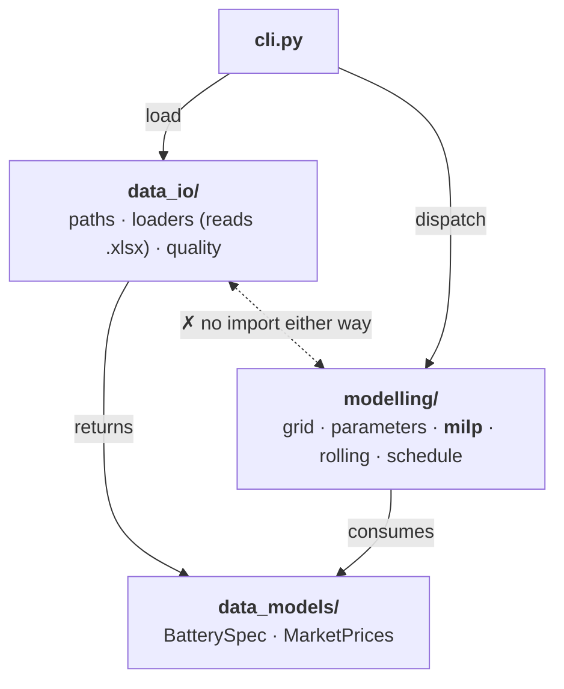
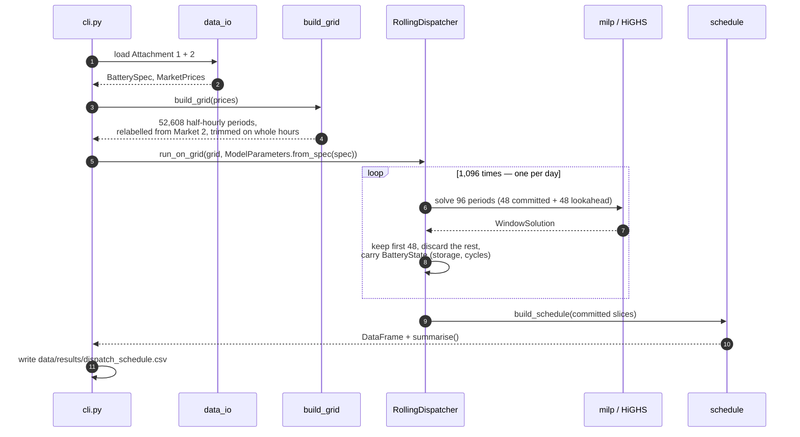
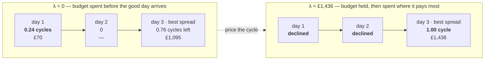

# Inside the dispatch model

How the three packages fit together, why each class exists, and the one place
where decomposing the horizon quietly broke a constraint that looked fine — the
global cycle budget.

*Companion to [`../README.md`](../README.md) (the tour) and
[`model/model.md`](model/model.md) (the formulation, §1–§7).*

| £207,365 | 1,096 | 37 | 1,137 |
| :--: | :--: | :--: | :--: |
| profit, 2018–2020 | MILPs per solve | tests | lines under `src/` |

**Contents** · [One organizing idea](#1-one-organizing-idea-the-code-is-the-write-up) ·
[Every file](#2-every-file-and-the-decision-inside-it) ·
[A solve, step by step](#3-what-actually-happens-in-a-solve) ·
[The cycle budget](#4-the-cycle-budget) ·
[What's checked](#5-what-is-checked-and-what-a-reviewer-should-still-doubt)

---

## 1. One organizing idea: the code is the write-up

The formulation lives in [`model/model.md`](model/model.md) as numbered
sections. Every module under `modelling/` owns a contiguous range of those
sections and says so in its first line, so a reviewer reading §4.5 can open
exactly one file and find exactly one implementation of it. That is the whole
filing principle — not "models, services, utils", but *the paragraphs this code
is answerable to*.

On top of that sits a dependency rule worth stating, because it is what keeps
the package honest: **the model cannot read a file, and the loaders cannot
model.** `data_models/` imports nothing of ours. `data_io/` and `modelling/`
both depend on it and never on each other. `cli.py` is the only module that
touches both.



`milp` is the only module that knows a solver exists; everything above it deals
in arrays and dataclasses.

### Why this, and not a flat package

Flat was the starting point, and it broke down for one concrete reason:
`data.py` held the spreadsheet loaders, a `MarketPrices` container *and* a
data-quality report, so "what shape is the input" and "how do we read the input"
could not be imported separately. Splitting on **noun / acquisition / decision**
rather than on file type means the MILP tests need no spreadsheet and the loader
tests need no solver — which is why the suite runs in six seconds.

---

## 2. Every file, and the decision inside it

### `data_models` — plain containers, no behaviour that could be wrong

**`BatterySpec`** · `data_models/battery.py` · §2
Frozen `slots` dataclass whose ten fields mirror Attachment 1 row for row, *in
the spreadsheet's own units* — loss fractions as fractions, degradation in
percent. Keeping the odd units here makes the loader trivially auditable against
the file; every conversion is pushed into `ModelParameters`, so there is exactly
one place to check them.

**`MarketPrices`** · `data_models/market_prices.py`
The two price series at their native resolutions, plus `start`, `end` and
`between()`. `between()` filters with a boolean mask rather than `.loc` slicing,
because the raw Market 1 index is *not monotonic* at the spring clock changes
and label slicing would raise there.

### `data_io` — acquisition, and a report instead of a repair

**`load_battery_spec`** · `data_io/loaders.py`
Reads Attachment 1 through `_SPEC_FIELDS`, an explicit *spreadsheet label →
field name* map, and raises listing every missing row rather than producing a
spec with a silent default. A renamed row in the source file becomes a loud
failure.

**`load_market_prices`** · `data_io/loaders.py`
The hourly sheet is laid out on the half-hourly grid with blank rows on the half
hours; those are dropped so each series keeps its own resolution. Timestamps are
rounded to the minute because Excel stores them as floats and some land on
`00:59:59.999`. Row order is preserved — it is the order the settlement periods
occur in, and the grid relies on it.

**`price_quality_report`** · `data_io/quality.py`
Counts duplicate timestamps, irregular steps and monotonicity per market, and
*returns them*. Deliberately not a cleaner: how to treat the clock-change
periods is a modelling decision, so it is made visibly in `grid.py` rather than
invisibly on load.

### `modelling` — the decision, section by section

**`DispatchGrid` · `build_grid`** · `modelling/grid.py` · §1, §5
Projects both markets onto one half-hourly grid as three aligned arrays
(`timestamps`, `price_1`, `price_2`), with the hourly price repeated across its
two half hours. Pairing is **positional**: every day holds exactly 48 and 24
rows, so position is trustworthy where the Market 1 *labels* are not — that
sheet labels the 01:00–02:00 hour as 02:00 at each spring change. Market 2's
labels are taken as canonical, which repairs the artefact without moving any
price off the period it was quoted for. `window()` and `between()` keep every
slice whole-hour aligned, so an hourly commitment can never be cut in half.

**`ModelParameters`** · `modelling/parameters.py` · §2
The spec in the model's units, built by `from_spec`: percent becomes a fraction,
and the cycle budget becomes an explicit input defaulting to the full cycle
life. `prorated_cycle_budget()` offers the other reading from §5 — three years
of a ten-year life is 1,500 cycles — so the assumption is a function argument a
reviewer can flip, not a number buried in a constraint.

**`BatteryState`** · `modelling/milp.py` · §4.2, §4.6
The two numbers a window must hand to the next: `storage_mwh` and `cycles`. A
named frozen pair rather than two loose floats, because the whole correctness of
the decomposition is "did the handover carry everything the constraints
integrate over" — and a type makes that question answerable by reading one line.
`EMPTY_BATTERY` is the *S*(0) = 0 start of §4.2.

**`build_problem` · `solve_window`** · `modelling/milp.py` · §3–§4.7
Building and solving are split so the program can be inspected without being
solved. Each constraint is added under a name matching the write-up
(`balance_t`, `cycles_t`, `storage_bound_t`, `charge_rate_t`, `hourly_charge_t`),
so a solver log naming an infeasible row points at a section number. Two
formulation choices are visible here: *S*<sub>max</sub>(*t*) is substituted out
instead of carried as a variable, as §4.7 permits, and the redundant §4.4
capacity constraints are omitted with a comment saying why.

**`WindowSolution`** · `modelling/milp.py`
Decisions as six numpy arrays plus the solver status, and
`state_after(periods)` — the only place that knows the handover is taken at the
end of the **committed** part, not the end of the solved window.

**`RollingDispatcher`** · `modelling/rolling.py` · §6
A frozen dataclass of four knobs (`commit_periods`, `lookahead_periods`,
`cycle_price`, `time_limit`) plus an optional `on_window` progress callback.
Frozen because `calibrate_cycle_price` needs to produce variants of a
configuration with `dataclasses.replace` and must not mutate the caller's.
`__post_init__` rejects a window that is not a whole number of hours — the one
invariant that would silently split a Market 2 commitment.

**`build_schedule` · `summarise`** · `modelling/schedule.py` · §7
Turns the arrays into the one DataFrame every figure is read off, with `COLUMNS`
fixing the contract. `summarise` recomputes profit, mean prices and cycles *from
those columns*, never from solver internals, so the number in the write-up and
the number in the file cannot diverge. `effective_volume` is §4.7 as a plain
function, which is also how the test checks the 5% loss at the cycle limit.

**`Dispatcher`** · `modelling/dispatch.py`
A `Protocol` — prices in, schedule out — not an abstract base class, so a
heuristic benchmark need not inherit anything to be scored by the same
`summarise`. Structural typing keeps the seam free of a class hierarchy nobody
asked for.

### Decisions that repeat across all of them

- **Frozen, slotted dataclasses everywhere.** Nothing in the pipeline mutates a
  spec, a parameter set or a state; a mutation bug across 1,096 windows would be
  near-impossible to see in the output, so it is made impossible to write
  instead.
- **numpy inside, pandas at the edges.** The grid and the solution are arrays;
  the schedule is a DataFrame. The hot loop never touches an index, and the
  output is still something you can `groupby`.
- **Module docstrings cite sections, comments cite constraints.** The mapping to
  the write-up is maintained in the code, not in a separate document that would
  drift.

---

## 3. What actually happens in a solve

`battery-case dispatch` over the full three years is **1,096 mixed-integer
programs, not one**. The horizon carries a binary per period, and solve time
grows steeply and erratically with window length — a day solves in 0.04 s, two
days in 0.2 s, a week in about 3 s, a fortnight anywhere from 5 to 17 s
depending which fortnight. So the horizon is walked instead.



One HiGHS instance is reused across every window.


Each window is solved with a day of foresight and committed for only half of
what it solved. The handover carries the state of charge and the cycle count
exactly — which is why the decomposition stays feasible, and why only the cycle
*budget* needed special handling.

**One day of lookahead is enough on this data.** Over June 2018, deciding each
day blind to the next costs 0.7%, and committing a whole week at a time earns
exactly the same £4,621 as one day with one day in view. A 4 MWh store that
fills in two hours does not have decisions that reach far beyond the day they
are taken in.

---

## 4. The cycle budget

> *A constraint that survives decomposition — and a calibration that didn't.*

§4.6 caps the horizon's total throughput: `n_cyc(T) ≤ 5,000` equivalent full
cycles. It is the only constraint in the formulation that couples periods
arbitrarily far apart, so it is the only one decomposition can get wrong — and
it got wrong in a way worth writing down, because the first implementation was
wrong in the *opposite* direction to the obvious guess.

### What each window actually enforces

Every window receives the cycles already spent in `BatteryState.cycles`,
accumulates from there, and caps the running total at the global budget. So the
budget **cannot be overspent**: the cap is enforced 1,096 times over, each time
against the true cumulative count. Feasibility was never the problem.

> [!WARNING]
> **The bug this exposed.** My first `calibrate_cycle_price` tested *"did the
> horizon use more cycles than the budget?"* and only then went looking for a
> price to ration them. That condition is **unreachable** — the per-window cap
> makes overspend impossible — so the calibration could never fire, and would
> have reported "nothing to do" on a horizon that was in fact mis-spending its
> entire budget. A test caught it: it asserted the unpriced run exceeded the cap,
> and the assert failed at 2.0 of 2.0 cycles rather than above it.

The real failure mode is **exhaustion, not overspend**. A window cannot see what
a later window would have paid for a cycle, so the earliest days that find any
profitable spread consume the budget, and the best spreads in the horizon arrive
to find it gone. The schedule is feasible, the cap is respected, and the answer
is quietly poor.

### The fix: price the budget instead of splitting it

Splitting the budget per window (say 4.56 cycles a day) would need to know in
advance which days deserve cycles — the thing the decomposition cannot know. So
the budget is *priced*. A charge `λ` per equivalent full cycle enters each
window's objective:

```python
# milp.py — objective, §3 with the cycle charge of §6
problem += (
    pulp.lpSum(
        dt
        * (
            grid.price_1[t] * (delivered * d1[t] - c1[t])
            + grid.price_2[t] * (delivered * d2[t] - c2[t])
        )
        for t in periods
    )
    - cycle_price * cycles_used  # cycles_used = n_cyc[-1] - state.cycles
)
```

Now a window spends a cycle only on a spread worth at least `λ` — it declines a
mediocre trade today because the charge prices in the possibility of a better
one later, without needing to know what that trade is. The `λ` wanted is the
budget's shadow price: **the largest charge at which the horizon still spends
its whole budget**. Below it the early days overbuy; above it cycles go unused
that would have paid for themselves. Cycle use falls monotonically in `λ`, so
`calibrate_cycle_price` bisects, re-solving the horizon at each step and keeping
the highest price that still spends the budget in full.

#### The regression test, with its real numbers

One cycle of budget, three days, and the best spread deliberately placed beyond
the lookahead.

| | day 1 — spread to £100 | day 2 — spread to £100 | day 3 — spread to £400 | total |
| --- | --- | --- | --- | --: |
| **λ = 0** | spends **0.24** cycles → £70 | 0 | only **0.76** left → £1,095 | **£1,165** |
| **λ = £1,436** | declined | declined | the **whole** cycle → £1,436 | **£1,436** |



Both runs spend the full 1.0-cycle budget and both respect the cap. Only the
allocation differs: £1,165 becomes £1,436 for the same single cycle.

> [!NOTE]
> **The subtlety that cost me a second test.** A binding cap does *not* imply a
> price helps. My first regression test used three identical days: the budget was
> exhausted early, pricing changed nothing, and profit was identical to the penny
> — correctly, because with identical days there is no misallocation to fix. The
> test only means something when the days differ **and** the better one sits
> beyond the lookahead, since a one-day lookahead already handles a next-day
> spread by itself.

### What this means for the actual answer

On the real three years with the full budget, the cap is never reached: **3,443
of 5,000 cycles**. The round-trip loss of §4.2 — 11% of spread needed before a
cycle breaks even — rules out the narrow spreads long before cycle life runs
out. So `λ = 0`, no rationing happens, and the decomposition's only cost is the
foresight past its lookahead, which June 2018 puts at under 1%.

Under the pro-rated 1,500-cycle budget from §5 it binds — 3,443 unrationed use
against 1,500 available — and `λ` becomes active. What it is worth there is
**not measured**: every bisection step re-solves the whole horizon at roughly
twelve minutes a pass, so a calibrated three-year run is a couple of hours of
compute rather than something to slip into a test suite.

---

## 5. What is checked, and what a reviewer should still doubt

The 37 tests are organized so that each constraint is tested by *the behaviour
it exists to produce*, not by re-asserting its algebra.
`tests/helpers.py::assert_feasible` re-derives §4.1 through §4.7 from any
schedule, and is run against synthetic shapes, the clock-change week, and the
full three-year output.

| File | Tests | Covers |
| --- | --: | --- |
| `test_milp.py` | 11 | Each constraint by the behaviour it produces: flat prices stay idle, a 5% spread is declined against the 0.9025 round trip, a dear Market 2 never tempts a simultaneous buy-and-sell, Market 2 holds flat across the hour while Market 1 moves within it, cycles accrue on discharge only, degradation blocks a refill to nominal |
| `test_rolling.py` | 10 | The handover, the discarded lookahead, one window reproducing the undecomposed solve exactly, and both cycle-budget cases — ample and binding |
| `test_grid.py` | 5 | Hourly prices repeated across their pair, the mislabelled spring hour relabelled without reordering prices, whole-hour slicing, mismatched resolutions rejected |
| `test_schedule.py` | 5 | Revenue priced on energy delivered not drawn, solver noise reported as zero, §4.7 volumes, empty-schedule summary |
| `test_data_io.py` | 4 | The spec against Attachment 1, both series at their native resolutions, the clock-change artefacts flagged |
| `test_cli.py` | 2 | Both commands end to end, including the written schedule's dates and length |

### Two things found by checking rather than by thinking

- **A 1.36 µW artefact.** Verifying the saved three-year schedule against §4.3
  failed on one period out of 52,608: the solver returned a charge variable at
  1e-6 MW while discharging, and the zero-cleaning threshold sat at exactly
  1e-6. A MILP is solved to a tolerance, not exactly, so the threshold is now
  10 W — an order of magnitude above the solver's feasibility tolerance — with a
  test for it. Profit was unchanged to the penny; the schedule now passes the
  check with no post-processing.
- **A lost output file.** The first full run printed its results and then died
  writing parquet, which needs an engine this project doesn't ship. The default
  is CSV now, covered by a CLI test.

### Still open

- The value of cycle rationing under the pro-rated budget, as above — the one
  number the implementation can produce but hasn't.
- Foresight is checked on one month (June 2018). A month where the cycle budget
  mattered would test it harder.
- No heuristic benchmark exists yet. The `Dispatcher` protocol is there so one
  can be scored by the same `summarise`, which is the cheapest way to find out
  whether the MILP is earning its complexity.

---

Figures from `data/results/dispatch_schedule.csv`, reproduced identically across
two independent full-horizon runs. Formulation:
[`model/model.md`](model/model.md) §1–§7.
