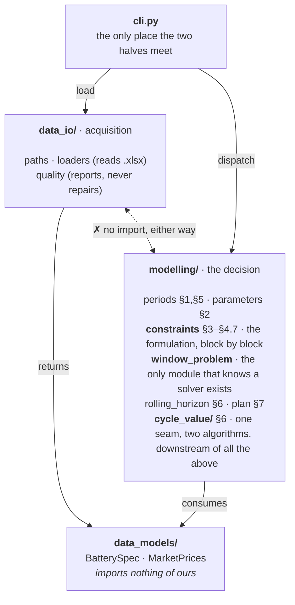

# Architecture

*How the code is structured, every class with the reason it exists, why the constraints are separate blocks, and how two search algorithms share one seam.*

[← README](../README.md) · [data](data.md) · [solve](solve.md) ·
[cycle budget](cycle-budget.md) · [validation](validation.md) ·
[glossary](glossary.md)

---

## 1. One organizing idea: code <-> methodology parity

The formulation lives in [`model/model.md`](model/model.md) as numbered sections. Every module under `modelling/` owns a contiguous range of those sections and says so in its first line, so a reviewer reading §4.5 can open exactly one file and find exactly one implementation of it. The filing principle is the paragraphs the code is answerable to, rather than the usual "models, services, utils".

| Module | Sections | What it holds |
| --- | --- | --- |
| `modelling/periods.py` | §1, §5 | Both markets on one half-hourly axis |
| `modelling/parameters.py` | §2 | The spec in the model's units |
| `modelling/constraints.py` | §3–§4.7 | The objective and the constraints, one block per section |
| `modelling/window_problem.py` | §3–§4.7 | Assembles, solves and reads back one window's MILP |
| `modelling/rolling_horizon.py` | §6 | The window sequence covering the horizon |
| `modelling/cycle_value/oracle.py` | §6 | The seam: one pass of the horizon, as an oracle |
| `modelling/cycle_value/bisection.py` | §6 | Finding the cycle value by bisection |
| `modelling/cycle_value/cutting_plane.py` | §6 | Finding it by cutting planes, with a bound |
| `modelling/cycle_value/searches.py` | §6 | The methods on offer, by the name that selects one |
| `modelling/cycle_value/calibrated_policy.py` | §6 | A calibrated run, as a `DispatchPolicy` |
| `modelling/plan.py` | §7 | The plan and the figures read off it |

One dependency rule holds the package together: **the model cannot read a file, and the loaders cannot model.** `data_models/` imports nothing of ours. `data_io/` and `modelling/` both depend on it and never on each other. `cli.py` is the only module that touches both. Inside `modelling/` the same rule runs once more: `cycle_value/` is the outer search for the budget's value and depends on the formulation beside it, while nothing in the formulation imports from `cycle_value/`. Six modules used to share §6 in one flat listing; the five that search for the value are now a package of their own, leaving `rolling_horizon.py` as the §6 the formulation owns.



### Why this, and not a flat package

Splitting on **noun / acquisition / decision** rather than on file type means the MILP tests need no spreadsheet and the loader tests need no solver, so most of the suite needs neither to run.

```
src/battery_case/
  data_models/      typed containers for the inputs, with no behaviour of their own
    battery.py        BatterySpec
    market_prices.py  MarketPrices
  data_io/          acquisition, and a report instead of a repair
    paths.py          where the inputs and outputs live
    loaders.py        spreadsheet loaders
    quality.py        the data quality report
  modelling/        the dispatch model, section by section of model.md
    periods.py            §1, §5
    parameters.py         §2
    constraints.py        §3–§4.7, one block per section
    window_problem.py     builds, solves and reads back one window
    rolling_horizon.py    §6, the window sequence
    plan.py               §7
    policy.py             the DispatchPolicy protocol
    cycle_value/      §6, the outer search for the budget's value
      oracle.py             the search seam and its oracle
      bisection.py          the cycle value by bisection
      cutting_plane.py      the cycle value by cutting planes
      searches.py           the registry of methods
      calibrated_policy.py  a calibrated run as a DispatchPolicy
  cli.py            the `battery-case` command
```

---

## 2. Decision decision

### `data_models`: plain containers with no behaviour of their own

**`BatterySpec`** · `data_models/battery.py` 

§2 Frozen `slots` dataclass whose ten fields mirror Attachment 1 row for row, in the spreadsheet's own units. Keeping the odd units here makes the loader auditable against the file; every conversion is pushed into `ModelParameters`, so there is exactly one place to check them. ([the fields](data.md#attachment-1-the-battery))

**`MarketPrices`** · `data_models/market_prices.py` 

The two price series at their native resolutions, plus `start`, `end` and `between()`. `between()` filters with a boolean mask rather than `.loc` slicing, because the raw Market 1 index is [not monotonic](data.md#the-quirks-surfaced-and-deliberately-not-repaired) at the spring clock changes and label slicing would raise there.

### `data_io`: file operations

**`load_battery_spec`** · `data_io/loaders.py`

Reads Attachment 1 through an explicit *spreadsheet label → field name* map and raises listing every missing row rather than defaulting silently.

**`load_market_prices`** · `data_io/loaders.py`

Drops the blank half-hour rows so each series keeps its own resolution, rounds Excel's float timestamps to the minute, and preserves row order, which is the order the settlement periods occur in and which the half-hourly axis relies on.

**`price_quality_report`** · `data_io/quality.py`

Counts duplicate timestamps, irregular steps and monotonicity per market, and *returns* them. Not a cleaner: the clock-change periods are a modelling decision, made visibly in `periods.py`.

### `modelling`

**`SettlementPeriods` · `build_periods`** · `modelling/periods.py` · §1, §5 

Projects both markets onto one half-hourly axis as three aligned arrays (`timestamps`, `price_1`, `price_2`), with the hourly price repeated across its two half hours. Pairing is [positional](data.md#why-pairing-is-positional) and Market 2's labels are canonical. `window()` and `between()` keep every slice whole-hour aligned, so an hourly commitment can never be cut in half.

**`ModelParameters`** · `modelling/parameters.py` · §2

The spec in the model's units, built by `from_spec`: percent becomes a fraction, and the cycle budget becomes an explicit input defaulting to the full cycle life. `prorated_cycle_budget()` offers the other reading from §5, three years of a ten-year life being 1,500 cycles, so the assumption is a function argument a reviewer can flip rather than a number buried in a constraint.

**`BatteryState`** · `modelling/constraints.py` · §4.2, §4.6

The two numbers a window must hand to the next: `storage_mwh` and `cycles`. A named frozen pair rather than two loose floats, because the correctness of the decomposition rests on whether the handover carries everything the constraints integrate over, and a type makes that question answerable by reading one line. `EMPTY_BATTERY` is the *S*(0) = 0 start of §4.2.

**The constraint blocks** · `modelling/constraints.py` · §3–§4.7

One function per section (`energy_balance` §4.2, `cycle_accounting` §4.6, `volume_limit` §4.1+§4.7, `mode_exclusivity` §4.3, `hourly_commitment` §4.5, `cycle_life_cap` §4.6), each taking the problem and a `ModelContext` and adding its own rows, collected in `DEFAULT_BLOCKS`. This makes the constraint build testable section by section.

Each constraint is added under a name matching the write-up (`balance_t`, `cycles_t`, `storage_bound_t`, `charge_rate_t`, `hourly_charge_t`), so a solver log naming an infeasible row points at a section number. 

Two formulation choices are visible here: *S*<sub>max</sub>(*t*) is substituted out instead of
carried as a variable, as §4.7 permits, and the redundant §4.4 capacity constraints are omitted with a comment saying why.

**`ModelContext` · `DispatchVariables`** · `modelling/constraints.py`

What a block is allowed to read: the settlement periods, the parameters, the opening state, the variables, and the cycle value. `previous_storage(t)` and `previous_cycles(t)` are the one place that knows period 0 reads the handover and every other period reads *t*-1, a rule that would otherwise be repeated in two blocks. `DispatchVariables` names the seven variable lists, replacing a
`dict[str, list[LpVariable]]` whose keys callers had to spell correctly.

**`build_problem` · `solve_window`** · `modelling/window_problem.py`

Building and solving are split so the program can be inspected and tested without being solved. `build_problem` declares the variables, sets the objective and folds `blocks` over the problem, and does nothing else, so the blocks are the only source of rows. `blocks` defaults to the whole of §4 and is the counterfactual lever: omitting `hourly_commitment` and re-solving prices Market 2's hourly commitment (§4.5) in pounds, with no new model code to write or keep correct.

**`WindowSolution`** · `modelling/window_problem.py`

Decisions as six numpy arrays plus the solver status, and `state_after(periods)`, the only place that knows the handover is taken at the end of the **committed** part rather than the end of the solved window.

**`RollingPolicy`** · `modelling/rolling_horizon.py` · §6

A frozen dataclass of five knobs (`commit_periods`, `lookahead_periods`, `cycle_value`, `blocks`, `time_limit`) plus an optional `on_window` progress callback. Frozen because [the searches](model/cycle-value-experiments.md) need variants of a configuration without mutating the caller's:
`replace(policy, cycle_value=λ, blocks=UNCAPPED_BLOCKS)` is a whole relaxed pass. `blocks` is what makes the policy serve both the capped and the relaxed subproblem without knowing which method asked. `__post_init__` rejects a window that is not a whole number of hours, the one invariant that would silently split a Market 2 commitment. What it does with those windows is
[the solve](solve.md).

**`build_plan` · `summarise`** · `modelling/plan.py` · §7

Turns the arrays into the one DataFrame every figure is read off, with `COLUMNS` fixing the contract. `summarise` recomputes profit, mean prices and cycles *from those columns*, never from solver internals, so the number in the write-up and the number in the file cannot diverge. `effective_volume` is §4.7 as a plain function, which is also how the test checks the 5% loss at the cycle limit.

**`DispatchPolicy`** · `modelling/policy.py`

A `Protocol` taking prices and returning a plan, rather than an abstract base class, so a heuristic benchmark need not inherit anything to be scored by the same `summarise`. Structural typing keeps a class hierarchy out of the seam.

**`CycleOracle` · `DualPoint`** · `modelling/cycle_value/oracle.py` · §6

One pass of the horizon at one charge, memoised on `(price, relaxed)` and counted. The pass is the unit of cost, ~77 seconds on the three-year horizon, so it is written once and `oracle.passes` is the number any comparison of methods turns on rather than a figure each method reports about itself. `DualPoint` is what a pass yields: the Lagrangian value, the exact subgradient, the profit, the cycles, the plan, and whether that plan is deliverable.

**`DualSearch` · `SEARCHES`** · `modelling/cycle_value/oracle.py` · `modelling/cycle_value/searches.py` · §6

The seam between the budget's price and the method that finds it, and the catalogue of methods behind it. Covered in [§4](#4-how-to-obtain-the-lagrangian-price-cutting-planes-and-bissection).

**`DualSearchResult` · `DualBound`** · `modelling/cycle_value/oracle.py` · §6

What a search returns. `bound` is `DualBound | None`: bisection reads one bit per pass and has no certificate to give, so the absence is expressed in the type rather than as a sentinel number.

**`CalibratedPolicy`** · `modelling/cycle_value/calibrated_policy.py` · §6

Values the budget, then dispatches at that value, implementing `DispatchPolicy` while doing it, so `summarise`, the CLI and the notebooks keep their single `run(spec, prices)` seam. `calibrate_and_dispatch` is the wider door for a caller that wants the cycle value, the pass count and the bound as well as the plan.

---

## 3. The formulation as constraint blocks

Each section of the model is a function that takes the problem and a context, and adds its own rows:

```python
ConstraintBlock = Callable[[pulp.LpProblem, ModelContext], None]


def energy_balance(problem: pulp.LpProblem, ctx: ModelContext) -> None:
    """§4.2 energy balance. ..."""
    for t in ctx.periods:
        problem += (..., f"balance_{t}")


DEFAULT_BLOCKS: tuple[ConstraintBlock, ...] = (
    energy_balance,  # §4.2
    cycle_accounting,  # §4.6
    volume_limit,  # §4.1 + §4.7
    mode_exclusivity,  # §4.3
    hourly_commitment,  # §4.5
    cycle_life_cap,  # §4.6
)
```

and `build_problem` is the builder that folds them over one problem. In full:

```python
problem = pulp.LpProblem("battery_dispatch", pulp.LpMaximize)
ctx = ModelContext.declare(problem, settlement, params, state, cycle_value=cycle_value)

profit_objective(problem, ctx)
for block in blocks:
    block(problem, ctx)
```

This is a **Strategy** pattern (each block is an interchangeable implementation of "impose a constraint family") composed as a **Composite** (a tuple of blocks is itself a formulation) and assembled by a **Builder** (`build_problem` owns the construction order and hands back a finished
problem). `ModelContext` is the **Parameter Object** that keeps the strategy signature to two arguments instead of six, and `DispatchVariables` replaces a `dict[str, list[LpVariable]]` whose keys every caller had to spell correctly.

### Why these, and not the alternatives

| Considered | Rejected because |
| --- | --- |
| **Private helpers**, `_add_energy_balance(problem, settlement, params, var, state)` | Fixes readability only. Without a context each helper takes five positional arguments, and the set of constraints stays hard-coded, so nothing becomes swappable or separately testable. |
| **Class per constraint**, `class EnergyBalance(ConstraintBlock)` | A class earns its place when it carries configuration. No block has any: every number a block needs is already in `ModelParameters`, and `cycle_value` belongs to the objective. It would be a hierarchy for one method. |

### What it buys

- **A section is testable without a solver.** `test_constraints.py` builds a
  context, calls one block, and asserts on the rows it added: 12 tests that
  catch a block adding nothing, or adding §4.5's rows to the wrong periods. The
  previous design could only test the assembled model, through a solve.
- **A constraint can be valued.** `blocks` is an argument, so omitting one and
  re-solving measures what it costs. Over week 1 of the real prices, dropping
  `hourly_commitment` lifts profit from £1,231.12 to £1,249.80, so the hourly
  commitment of §4.5 costs about £19 a week, measured with no new model code to
  write or keep correct. `relaxing(*blocks)` is that omission as a named
  operation, and it is what [§4](#4-how-to-obtain-the-lagrangian-price-cutting-planes-and-bissection) builds
  the Lagrangian relaxation of the cycle budget from. Two caveats, both stated in
  the blocks' own docstrings: a constraint that is also a *variable bound* is
  not relaxed by dropping its row, which is why §4.6's cap is a row alone, and
  §4.3 is one inequality, so dropping it removes the rate caps along with the
  binary.
- **One rule, one place.** `ctx.previous_storage(t)` and
  `ctx.previous_cycles(t)` are the only code that knows period 0 reads the
  handover while every other period reads *t*-1, rather than each constraint
  family repeating the rule.
- **Adding §4.8 is additive.** Write a function, append it to
  `DEFAULT_BLOCKS`. Nothing existing is touched, so nothing existing can break.

---

## 4. How to obtain the lagrangian price: cutting planes and bissection

§4.6's cycle budget is the one constraint that couples distant windows, so it is handled by valuing rather than splitting ([cycle budget](cycle-budget.md)).
Finding the dual value is a search, and there is more than one way to run it: the
bisection (brute force), and Kelley's cutting-plane method on the
Lagrangian dual, which costs about half the passes and returns a bound on the
answer. Both are in the package and both are selectable:

```bash
uv run battery-case dispatch --search                 # cutting planes, the default
uv run battery-case dispatch --search bisection      # the reference method
uv run python scripts/compare_searches.py 30
```

### The decision that shaped it: a method owns its subproblem

One function with a `method="bisection" | "cutting-plane"`
flag does not work, because **the two methods do not search the same
subproblem.**

Bisection reads one bit per pass, *was the budget exhausted?*, and that bit only
exists when the window **caps** the cumulative count. The cutting-plane
method reads a value and a subgradient, and those are only meaningful when the
cap is **removed** and replaced by the lagrangian. The
numbers are in [cycle-value experiments §1](model/cycle-value-experiments.md#1-what-a-pass-has-to-report).

So "which algorithm" and "which subproblem" are one choice. A method flag would
have had to reach from the outer search down into model construction, re-coupling
the search to the formulation that
[§3](#3-the-formulation-as-constraint-blocks) decoupled. Instead a search *is* a
pair: a search rule, and the relaxation it searches over.

### The shape

Four layers, each depending only downwards:

```
cycle_value/bisection.py · cycle_value/cutting_plane.py   the two search rules
  ──────────────── DualSearch ────────────────   the seam; SEARCHES is the catalogue
cycle_value/oracle.py · CycleOracle.at(λ, relaxed=…) → DualPoint
rolling_horizon.py · RollingPolicy(blocks=…)  one pass over the horizon
constraints.py · DEFAULT_BLOCKS / UNCAPPED_BLOCKS
```

A search's whole job is choosing which cycle value to spend the next pass on. What a
pass *is* belongs to the oracle; what a window *is* belongs to the layers below.
Neither search imports `pulp` for the model, and the window loop never learns
that an outer search exists.

| Pattern | Where | What it buys here |
| --- | --- | --- |
| **Strategy** | `DualSearch` and its two implementations | The search rule is the only thing that varies between methods, and it varies behind one call. |
| **Protocol**, not an ABC | `DualSearch` | Matches `DispatchPolicy`, which is already a `Protocol`: a search inherits nothing, and an experiment in a notebook satisfies the seam by having the method. |
| **Oracle** | `CycleOracle.at` | The whole-horizon pass is written once, memoised and counted in one place, so the pass count that decides the comparison is measured rather than self-reported. |
| **Decorator** | `CalibratedPolicy` | Implements `DispatchPolicy` by valuing the budget first and dispatching second, so nothing downstream changes. |
| **Registry** | `SEARCHES` | One dict turns a CLI string into a method and is the list a reviewer reads. The key *is* the name, with no `name` attribute on the classes, the same decision as the blocks. |
| **Parameter object** | `CycleOracle`, `DualPoint` | Keeps `price(oracle)` at one argument instead of five, which is what lets the protocol stay small. |

---

## 5. Decisions that repeat across all of them

- **Frozen, slotted dataclasses everywhere.** Nothing in the pipeline mutates a
  spec, a parameter set or a state. 
- **numpy inside, pandas at the edges.** The settlement periods and the solution are arrays
  and the plan is a DataFrame, so the hot loop never touches an index while
  the output can still be grouped and plotted.
- **Module docstrings cite sections, comments cite constraints.** The mapping to
  the write-up is maintained in the code, not in a separate document that would
  drift.
