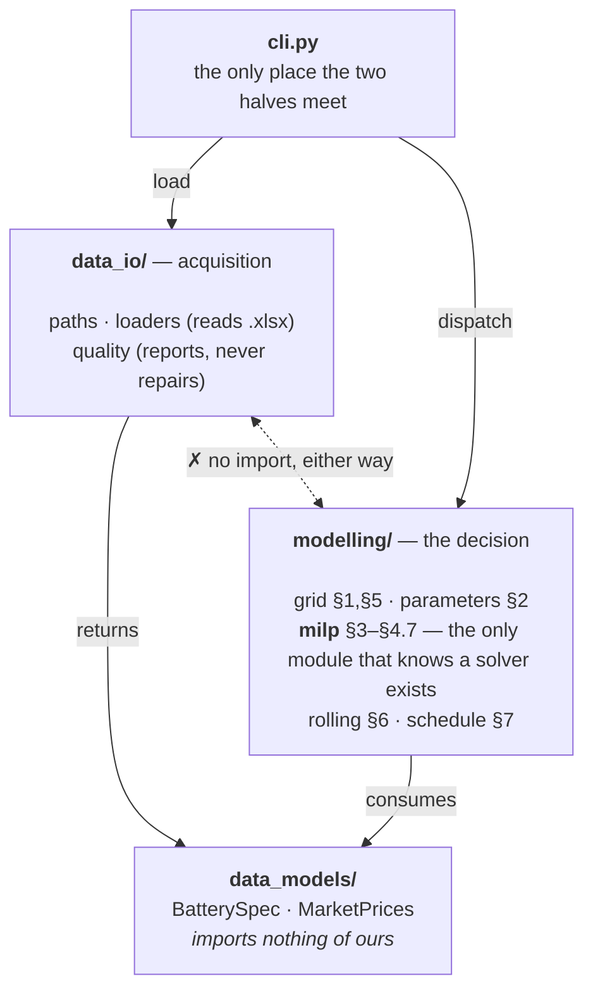

# Architecture

*How the code is filed, the one dependency rule, and every class with the
reason it exists.*

[← README](../README.md) · [data](data.md) · [solve](solve.md) ·
[cycle budget](cycle-budget.md) · [validation](validation.md)

---

## 1. One organizing idea: the code is the write-up

The formulation lives in [`model/model.md`](model/model.md) as numbered
sections. Every module under `modelling/` owns a contiguous range of those
sections and says so in its first line, so a reviewer reading §4.5 can open
exactly one file and find exactly one implementation of it. That is the whole
filing principle — not "models, services, utils", but *the paragraphs this code
is answerable to*.

| Module | Sections | What it holds |
| --- | --- | --- |
| `modelling/grid.py` | §1, §5 | Both markets on one half-hourly grid |
| `modelling/parameters.py` | §2 | The spec in the model's units |
| `modelling/milp.py` | §3–§4.7 | Objective and constraints, one window |
| `modelling/rolling.py` | §6 | The window sequence covering the horizon |
| `modelling/schedule.py` | §7 | The schedule and the figures read off it |

On top of that sits a dependency rule worth stating, because it is what keeps
the package honest: **the model cannot read a file, and the loaders cannot
model.** `data_models/` imports nothing of ours. `data_io/` and `modelling/`
both depend on it and never on each other. `cli.py` is the only module that
touches both.



### Why this, and not a flat package

Flat was the starting point, and it broke down for one concrete reason:
`data.py` held the spreadsheet loaders, a `MarketPrices` container *and* a
data-quality report, so "what shape is the input" and "how do we read the
input" could not be imported separately. Splitting on **noun / acquisition /
decision** rather than on file type means the MILP tests need no spreadsheet
and the loader tests need no solver — which is why the suite runs in six
seconds.

```
src/battery_case/
  data_models/      typed containers for the inputs — no behaviour that could be wrong
    battery.py        BatterySpec
    market_prices.py  MarketPrices
  data_io/          acquisition, and a report instead of a repair
    paths.py          where the inputs and outputs live
    loaders.py        spreadsheet loaders
    quality.py        the data quality report
  modelling/        the dispatch model, section by section of model.md
    grid.py           §1, §5
    parameters.py     §2
    milp.py           §3–§4.7
    rolling.py        §6
    schedule.py       §7
    dispatch.py       the Dispatcher protocol
  cli.py            the `battery-case` command
```

---

## 2. Every file, and the decision inside it

### `data_models` — plain containers, no behaviour that could be wrong

**`BatterySpec`** · `data_models/battery.py` · §2
Frozen `slots` dataclass whose ten fields mirror Attachment 1 row for row, in
the spreadsheet's own units. Keeping the odd units here makes the loader
auditable against the file; every conversion is pushed into `ModelParameters`,
so there is exactly one place to check them. ([the fields](data.md#attachment-1--the-battery))

**`MarketPrices`** · `data_models/market_prices.py`
The two price series at their native resolutions, plus `start`, `end` and
`between()`. `between()` filters with a boolean mask rather than `.loc`
slicing, because the raw Market 1 index is [not monotonic](data.md#the-quirks-surfaced-and-deliberately-not-repaired)
at the spring clock changes and label slicing would raise there.

### `data_io` — acquisition, and a report instead of a repair

**`load_battery_spec`** · `data_io/loaders.py`
Reads Attachment 1 through an explicit *spreadsheet label → field name* map and
raises listing every missing row rather than defaulting silently.

**`load_market_prices`** · `data_io/loaders.py`
Drops the blank half-hour rows so each series keeps its own resolution, rounds
Excel's float timestamps to the minute, and preserves row order — it is the
order the settlement periods occur in, and the grid relies on it.

**`price_quality_report`** · `data_io/quality.py`
Counts duplicate timestamps, irregular steps and monotonicity per market, and
*returns* them. Deliberately not a cleaner: the clock-change periods are a
modelling decision, made visibly in `grid.py`.

### `modelling` — the decision, section by section

**`DispatchGrid` · `build_grid`** · `modelling/grid.py` · §1, §5
Projects both markets onto one half-hourly grid as three aligned arrays
(`timestamps`, `price_1`, `price_2`), with the hourly price repeated across its
two half hours. Pairing is [positional](data.md#why-pairing-is-positional) and
Market 2's labels are canonical. `window()` and `between()` keep every slice
whole-hour aligned, so an hourly commitment can never be cut in half.

**`ModelParameters`** · `modelling/parameters.py` · §2
The spec in the model's units, built by `from_spec`: percent becomes a
fraction, and the cycle budget becomes an explicit input defaulting to the full
cycle life. `prorated_cycle_budget()` offers the other reading from §5 — three
years of a ten-year life is 1,500 cycles — so the assumption is a function
argument a reviewer can flip, not a number buried in a constraint.

**`BatteryState`** · `modelling/milp.py` · §4.2, §4.6
The two numbers a window must hand to the next: `storage_mwh` and `cycles`. A
named frozen pair rather than two loose floats, because the whole correctness
of the decomposition is "did the handover carry everything the constraints
integrate over" — and a type makes that question answerable by reading one
line. `EMPTY_BATTERY` is the *S*(0) = 0 start of §4.2.

**`build_problem` · `solve_window`** · `modelling/milp.py` · §3–§4.7
Building and solving are split so the program can be inspected without being
solved. Each constraint is added under a name matching the write-up
(`balance_t`, `cycles_t`, `storage_bound_t`, `charge_rate_t`,
`hourly_charge_t`), so a solver log naming an infeasible row points at a
section number. Two formulation choices are visible here:
*S*<sub>max</sub>(*t*) is substituted out instead of carried as a variable, as
§4.7 permits, and the redundant §4.4 capacity constraints are omitted with a
comment saying why.

**`WindowSolution`** · `modelling/milp.py`
Decisions as six numpy arrays plus the solver status, and
`state_after(periods)` — the only place that knows the handover is taken at the
end of the **committed** part, not the end of the solved window.

**`RollingDispatcher`** · `modelling/rolling.py` · §6
A frozen dataclass of four knobs (`commit_periods`, `lookahead_periods`,
`cycle_price`, `time_limit`) plus an optional `on_window` progress callback.
Frozen because [`calibrate_cycle_price`](cycle-budget.md#the-fix-price-the-budget-instead-of-splitting-it)
needs to produce variants of a configuration with `dataclasses.replace` and
must not mutate the caller's. `__post_init__` rejects a window that is not a
whole number of hours — the one invariant that would silently split a Market 2
commitment. What it does with those windows is [the solve](solve.md).

**`build_schedule` · `summarise`** · `modelling/schedule.py` · §7
Turns the arrays into the one DataFrame every figure is read off, with
`COLUMNS` fixing the contract. `summarise` recomputes profit, mean prices and
cycles *from those columns*, never from solver internals, so the number in the
write-up and the number in the file cannot diverge. `effective_volume` is §4.7
as a plain function, which is also how the test checks the 5% loss at the cycle
limit.

**`Dispatcher`** · `modelling/dispatch.py`
A `Protocol` — prices in, schedule out — not an abstract base class, so a
heuristic benchmark need not inherit anything to be scored by the same
`summarise`. Structural typing keeps the seam free of a class hierarchy nobody
asked for.

---

## 3. Decisions that repeat across all of them

- **Frozen, slotted dataclasses everywhere.** Nothing in the pipeline mutates a
  spec, a parameter set or a state; a mutation bug across 1,096 windows would be
  near-impossible to see in the output, so it is made impossible to write
  instead.
- **numpy inside, pandas at the edges.** The grid and the solution are arrays;
  the schedule is a DataFrame. The hot loop never touches an index, and the
  output is still something you can `groupby`.
- **Module docstrings cite sections, comments cite constraints.** The mapping to
  the write-up is maintained in the code, not in a separate document that would
  drift.
