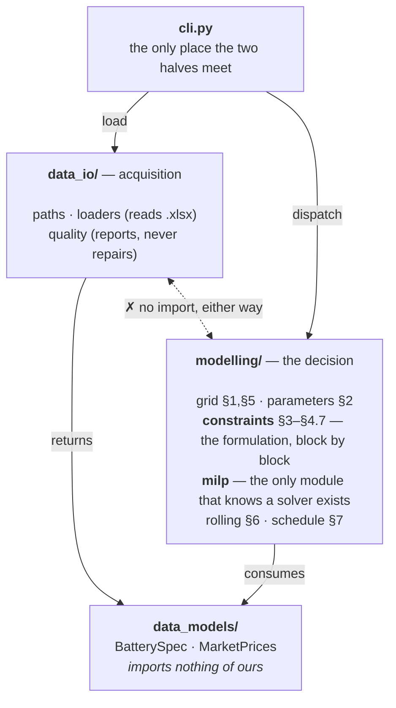

# Architecture

*How the code is filed, the one dependency rule, every class with the reason it
exists, and why the formulation is a list of constraint blocks.*

[← README](../README.md) · [data](data.md) · [solve](solve.md) ·
[cycle budget](cycle-budget.md) · [validation](validation.md)

---

## 1. One organizing idea: the code is the write-up

The formulation lives in [`model/model.md`](model/model.md) as numbered
sections. Every module under `modelling/` owns a contiguous range of those
sections and says so in its first line, so a reviewer reading §4.5 can open
exactly one file and find exactly one implementation of it. That is the whole
filing principle — not "models, services, utils", but *the paragraphs this code
is answerable to*.

| Module | Sections | What it holds |
| --- | --- | --- |
| `modelling/grid.py` | §1, §5 | Both markets on one half-hourly grid |
| `modelling/parameters.py` | §2 | The spec in the model's units |
| `modelling/constraints.py` | §3–§4.7 | The objective and the constraints, one block per section |
| `modelling/milp.py` | §3–§4.7 | Assembles, solves and reads back one window |
| `modelling/rolling.py` | §6 | The window sequence covering the horizon |
| `modelling/schedule.py` | §7 | The schedule and the figures read off it |

On top of that sits a dependency rule worth stating, because it is what keeps
the package honest: **the model cannot read a file, and the loaders cannot
model.** `data_models/` imports nothing of ours. `data_io/` and `modelling/`
both depend on it and never on each other. `cli.py` is the only module that
touches both.



### Why this, and not a flat package

Flat was the starting point, and it broke down for one concrete reason:
`data.py` held the spreadsheet loaders, a `MarketPrices` container *and* a
data-quality report, so "what shape is the input" and "how do we read the
input" could not be imported separately. Splitting on **noun / acquisition /
decision** rather than on file type means the MILP tests need no spreadsheet
and the loader tests need no solver — which is why most of the suite needs
neither to run.

```
src/battery_case/
  data_models/      typed containers for the inputs — no behaviour that could be wrong
    battery.py        BatterySpec
    market_prices.py  MarketPrices
  data_io/          acquisition, and a report instead of a repair
    paths.py          where the inputs and outputs live
    loaders.py        spreadsheet loaders
    quality.py        the data quality report
  modelling/        the dispatch model, section by section of model.md
    grid.py           §1, §5
    parameters.py     §2
    constraints.py    §3–§4.7, one block per section
    milp.py           builds, solves and reads back one window
    rolling.py        §6
    schedule.py       §7
    dispatch.py       the Dispatcher protocol
  cli.py            the `battery-case` command
```

---

## 2. Every file, and the decision inside it

### `data_models` — plain containers, no behaviour that could be wrong

**`BatterySpec`** · `data_models/battery.py` · §2
Frozen `slots` dataclass whose ten fields mirror Attachment 1 row for row, in
the spreadsheet's own units. Keeping the odd units here makes the loader
auditable against the file; every conversion is pushed into `ModelParameters`,
so there is exactly one place to check them. ([the fields](data.md#attachment-1--the-battery))

**`MarketPrices`** · `data_models/market_prices.py`
The two price series at their native resolutions, plus `start`, `end` and
`between()`. `between()` filters with a boolean mask rather than `.loc`
slicing, because the raw Market 1 index is [not monotonic](data.md#the-quirks-surfaced-and-deliberately-not-repaired)
at the spring clock changes and label slicing would raise there.

### `data_io` — acquisition, and a report instead of a repair

**`load_battery_spec`** · `data_io/loaders.py`
Reads Attachment 1 through an explicit *spreadsheet label → field name* map and
raises listing every missing row rather than defaulting silently.

**`load_market_prices`** · `data_io/loaders.py`
Drops the blank half-hour rows so each series keeps its own resolution, rounds
Excel's float timestamps to the minute, and preserves row order — it is the
order the settlement periods occur in, and the grid relies on it.

**`price_quality_report`** · `data_io/quality.py`
Counts duplicate timestamps, irregular steps and monotonicity per market, and
*returns* them. Deliberately not a cleaner: the clock-change periods are a
modelling decision, made visibly in `grid.py`.

### `modelling` — the decision, section by section

**`DispatchGrid` · `build_grid`** · `modelling/grid.py` · §1, §5
Projects both markets onto one half-hourly grid as three aligned arrays
(`timestamps`, `price_1`, `price_2`), with the hourly price repeated across its
two half hours. Pairing is [positional](data.md#why-pairing-is-positional) and
Market 2's labels are canonical. `window()` and `between()` keep every slice
whole-hour aligned, so an hourly commitment can never be cut in half.

**`ModelParameters`** · `modelling/parameters.py` · §2
The spec in the model's units, built by `from_spec`: percent becomes a
fraction, and the cycle budget becomes an explicit input defaulting to the full
cycle life. `prorated_cycle_budget()` offers the other reading from §5 — three
years of a ten-year life is 1,500 cycles — so the assumption is a function
argument a reviewer can flip, not a number buried in a constraint.

**`BatteryState`** · `modelling/constraints.py` · §4.2, §4.6
The two numbers a window must hand to the next: `storage_mwh` and `cycles`. A
named frozen pair rather than two loose floats, because the whole correctness
of the decomposition is "did the handover carry everything the constraints
integrate over" — and a type makes that question answerable by reading one
line. `EMPTY_BATTERY` is the *S*(0) = 0 start of §4.2.

**The constraint blocks** · `modelling/constraints.py` · §3–§4.7
One function per section — `energy_balance` §4.2, `cycle_accounting` §4.6,
`effective_volume` §4.1+§4.7, `mode_exclusivity` §4.3, `hourly_commitment`
§4.5, `cycle_life_cap` §4.6 — each taking the problem and a `ModelContext` and
adding its own rows, collected in `DEFAULT_BLOCKS`. The alternative was one
`build_problem` body with every family interleaved in a single period loop,
which is unreadable against the write-up and untestable section by section.
Each constraint is added under a name matching the write-up (`balance_t`,
`cycles_t`, `storage_bound_t`, `charge_rate_t`, `hourly_charge_t`), so a solver
log naming an infeasible row points at a section number. Two formulation
choices are visible here: *S*<sub>max</sub>(*t*) is substituted out instead of
carried as a variable, as §4.7 permits, and the redundant §4.4 capacity
constraints are omitted with a comment saying why.

**`ModelContext` · `DispatchVariables`** · `modelling/constraints.py`
What a block is allowed to read: the grid, the parameters, the opening state,
the variables, and the cycle price. `previous_storage(t)` and
`previous_cycles(t)` are the one place that knows period 0 reads the handover
and every other period reads *t*-1 — the rule that would otherwise be repeated
in two blocks. `DispatchVariables` names the seven variable lists, replacing a
`dict[str, list[LpVariable]]` whose keys callers had to spell correctly.

**`build_problem` · `solve_window`** · `modelling/milp.py`
Building and solving are split so the program can be inspected without being
solved. `build_problem` declares the variables, sets the objective and folds
`blocks` over the problem — nothing else, so the blocks are the only source of
rows. `blocks` defaults to the whole of §4 and is the counterfactual lever:
omitting `hourly_commitment` and re-solving prices Market 2's hourly commitment
(§4.5) in pounds, with no new model code to write or keep correct.

**`WindowSolution`** · `modelling/milp.py`
Decisions as six numpy arrays plus the solver status, and
`state_after(periods)` — the only place that knows the handover is taken at the
end of the **committed** part, not the end of the solved window.

**`RollingDispatcher`** · `modelling/rolling.py` · §6
A frozen dataclass of four knobs (`commit_periods`, `lookahead_periods`,
`cycle_price`, `time_limit`) plus an optional `on_window` progress callback.
Frozen because [`calibrate_cycle_price`](cycle-budget.md#the-fix-price-the-budget-instead-of-splitting-it)
needs to produce variants of a configuration with `dataclasses.replace` and
must not mutate the caller's. `__post_init__` rejects a window that is not a
whole number of hours — the one invariant that would silently split a Market 2
commitment. What it does with those windows is [the solve](solve.md).

**`build_schedule` · `summarise`** · `modelling/schedule.py` · §7
Turns the arrays into the one DataFrame every figure is read off, with
`COLUMNS` fixing the contract. `summarise` recomputes profit, mean prices and
cycles *from those columns*, never from solver internals, so the number in the
write-up and the number in the file cannot diverge. `effective_volume` is §4.7
as a plain function, which is also how the test checks the 5% loss at the cycle
limit.

**`Dispatcher`** · `modelling/dispatch.py`
A `Protocol` — prices in, schedule out — not an abstract base class, so a
heuristic benchmark need not inherit anything to be scored by the same
`summarise`. Structural typing keeps the seam free of a class hierarchy nobody
asked for.

---

## 3. The formulation as constraint blocks

The constraints of §4 were first written as one `build_problem` body: seven
`add_variable_matrix` calls, the objective, and five constraint families
interleaved inside a single `for t in periods` loop. It worked and it was
correct. It was also the one place in the package where the organizing idea of
§1 broke down — §4.1, §4.2, §4.3, §4.5 and §4.6 shared a loop body, so no
section could be read, tested or changed on its own, and the promise that "each
constraint block can be read against its section" survived only as a comment
convention.

### The pattern: one block per section, folded by the builder

Each section of the write-up is a function that takes the problem and a
context, and adds its own rows:

```python
ConstraintBlock = Callable[[pulp.LpProblem, ModelContext], None]

def energy_balance(problem: pulp.LpProblem, ctx: ModelContext) -> None:
    """§4.2 energy balance. ..."""
    for t in ctx.periods:
        problem += (..., f"balance_{t}")

DEFAULT_BLOCKS: tuple[ConstraintBlock, ...] = (
    energy_balance,        # §4.2
    cycle_accounting,      # §4.6
    effective_volume,      # §4.1 + §4.7
    mode_exclusivity,      # §4.3
    hourly_commitment,     # §4.5
    cycle_life_cap,        # §4.6
)
```

and `build_problem` is the builder that folds them over one problem — the whole
of it:

```python
problem = pulp.LpProblem("battery_dispatch", pulp.LpMaximize)
ctx = ModelContext.declare(problem, grid, params, state, cycle_price=cycle_price)

profit_objective(problem, ctx)
for block in blocks:
    block(problem, ctx)
```

In pattern vocabulary this is **Strategy** (each block is an interchangeable
implementation of "impose a constraint family") composed as a **Composite** (a
tuple of blocks is itself a formulation) and assembled by a **Builder**
(`build_problem` owns the construction order and hands back a finished
problem). `ModelContext` is the **Parameter Object** that keeps the strategy
signature to two arguments instead of six, and `DispatchVariables` replaces a
`dict[str, list[LpVariable]]` whose keys every caller had to spell correctly.

### Why these, and not the alternatives

| Considered | Rejected because |
| --- | --- |
| **Private helpers** — `_add_energy_balance(problem, grid, params, var, state)` | Fixes readability only. Without a context each helper takes five positional arguments, and the set of constraints stays hard-coded, so nothing becomes swappable or separately testable. |
| **Class per constraint** — `class EnergyBalance(ConstraintBlock)` | A class earns its place when it carries configuration. No block has any: every number a block needs is already in `ModelParameters`, and `cycle_price` belongs to the objective. It would be a hierarchy for one method. |
| **Visitor over an expression tree** | Would let constraints be rewritten rather than only added, which nothing here needs. PuLP already is the expression layer. |
| **Registry with a `@constraint("§4.2")` decorator** | Import-order-dependent and implicit. A tuple states the formulation in one place a reviewer can read top to bottom. |
| **Section metadata on the blocks** — `energy_balance.section = "§4.2"` | Nothing reads it. The citation belongs in the docstring, which is where the rest of the package already puts it. Dead metadata that can drift silently is worse than a comment that cannot. |

### What it buys

- **A section is testable without a solver.** `test_constraints.py` builds a
  context, calls one block, and asserts on the rows it added — 12 tests that
  catch a block adding nothing, or adding §4.5's rows to the wrong periods. The
  previous design could only test the assembled model, through a solve.
- **A constraint can be priced.** `blocks` is an argument, so omitting one and
  re-solving measures what it costs. Over week 1 of the real prices, dropping
  `hourly_commitment` lifts profit from £1,231.12 to £1,249.80, so the hourly
  commitment of §4.5 costs about £19 a week — measured with no new model code to
  write or keep correct.
- **One rule, one place.** `ctx.previous_storage(t)` and
  `ctx.previous_cycles(t)` are the only code that knows period 0 reads the
  handover while every other period reads *t*-1. That rule was previously
  repeated in two constraint families.
- **Adding §4.8 is additive.** Write a function, append it to
  `DEFAULT_BLOCKS`. Nothing existing is touched, so nothing existing can break.

### What it costs

Each block owns its own loop over periods, so the model is built in six passes
rather than one. Measured on the whole 52,608-period horizon — 315,649 rows —
that is 8.4 s to build against 8.2 s before, some 2%, set against a one-shot
solve an hour does not prove optimal
([tractability](model/tractability.md)). The shared loop was precisely what
forced unrelated sections into one body, so the trade is a fifth of a second for
the whole of §1's organizing idea.

The row names, bounds and the resulting program are unchanged. The refactor was
checked by holding three things fixed across it: the 289 row names of a
48-period grid, the 315,649 rows of the full horizon, and the £1,231.12 week-1
objective.

---

## 4. Decisions that repeat across all of them

- **Frozen, slotted dataclasses everywhere.** Nothing in the pipeline mutates a
  spec, a parameter set or a state; a mutation bug across 1,096 windows would be
  near-impossible to see in the output, so it is made impossible to write
  instead.
- **numpy inside, pandas at the edges.** The grid and the solution are arrays;
  the schedule is a DataFrame. The hot loop never touches an index, and the
  output is still something you can `groupby`.
- **Module docstrings cite sections, comments cite constraints.** The mapping to
  the write-up is maintained in the code, not in a separate document that would
  drift.
