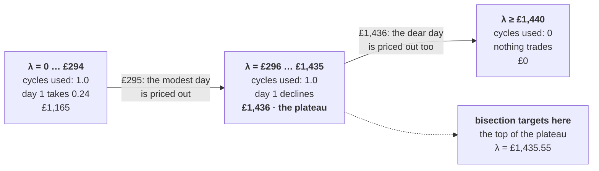

# Bisection on the price of a cycle

*The comparison method: what it searches for, what it costs, and what it cannot
certify.*

[← README](../README.md) · [cycle budget](cycle-budget.md) ·
[cycle-value experiments](model/cycle-value-experiments.md) ·
[architecture](architecture.md) · [validation](validation.md) ·
[glossary](glossary.md)

---

The cycle budget of §4.6 is valued rather than split, and the cycle value `λ` is
found by a search over whole passes of the horizon
([cycle budget](cycle-budget.md)). The **default** search is Kelley's cutting
planes on the dual of §6, which costs fewer passes and brackets its own answer
([there](cycle-budget.md#kelleys-cutting-planes-the-default)).

This page is the other one: a bisection on cycle use. It is kept for
**comparison**, and it earns that place for two reasons.

- **It is an independent check.** It is a different algorithm asking a different
  subproblem — one bit off a *capped* pass, where the cutting plane takes a value
  and a subgradient off a *relaxed* one. Beyond 90 days no exact solve can be
  built, so the only independent read on the default's plan at those sizes is
  a second method that arrives at it another way. Its deliverable also comes
  straight off a capped pass with no recovery step, which is what makes it the
  instrument for asking whether the default's 1.73% at three years is duality
  gap or recovery drift.
- **It assumes almost nothing.** Monotonicity of cycle use in `λ` is the whole
  theory, so it is the easiest way to see what `λ` *is* before any dual
  machinery is introduced.

Both methods are measured against each other, and against exactly solved
instances, in
[cycle-value experiments §2](model/cycle-value-experiments.md#2-what-each-method-costs-against-a-known-answer).
Select this one with `battery-case dispatch --search bisection`.

## What the search is searching over

The obvious target, "find the λ where cycle use equals the budget", does not
exist in general. Cycle use as a function of λ is a **step function**: trades
drop out one threshold at a time, so the curve is flat almost everywhere and
jumps where a day stops being worth a cycle. Measured on the three-day
instance of `tests/test_cycle_value.py`
([what it looks like](cycle-budget.md#what-it-looks-like)), with one cycle of
budget:

| λ (£/cycle) | Cycles used | Spent by day 1 | Gross profit | Regime |
| --- | --: | --: | --: | --- |
| 0 … 294 | 1.0000 | 0.2375 | £1,165.04 | budget spent in full, on the wrong days |
| 296 … 1,435 | 1.0000 | 0 | £1,435.79 | budget spent in full, on the best spread |
| 1,440 and up | 0.0000 | 0 | £0.00 | too dear to trade at all |



The two thresholds are the two days' marginal cycle values, and they are
visible to the pound: between £294 and £296 the modest day stops trading, and
between £1,435 and £1,440 the dear day does too. The middle column shows that
**cycle use alone cannot tell a good allocation from a bad one**, the budget
being spent in full on both sides of £295. What improves with λ is *where* it is
spent. The search therefore aims at the top of the plateau, the **highest λ at
which the budget is still fully spent**, which is the last λ before the most
valuable cycle in the horizon is itself priced out.

## The algorithm

```python
# bisection.py: BisectionSearch.price, reduced to its loop
# Probe at zero first: if the budget survives a free run, it does not bind.
best_schedule = run_whole_horizon(cycle_value=0.0)
if cycles_used(best_schedule) < budget * (1 - tolerance):
    return 0.0, best_schedule  # one pass, no bisection

low, high = 0.0, upper_bound  # invariant: low spends in full, high does not
for _ in range(max_iterations):  # 12
    price = 0.5 * (low + high)
    plan = run_whole_horizon(cycle_value=price)  # 1,096 window MILPs
    if cycles_used(plan) >= budget * (1 - tolerance):
        low = best_price = price  # still spends it all, so push the price up
        best_schedule = plan  # keep it, so no pass is wasted
    else:
        high = price  # priced out cycles that would have paid
return best_price, best_schedule
```

Four details that matter more than the bisection itself:

- **Each iteration is a whole horizon**, a full rolling pass of 1,096 MILPs
  rather than a single window. The calibrated run therefore costs `1 + 12`
  passes, about 17 minutes over three years at the measured ~77 s a pass. The
  pass is `CycleOracle.at(λ, relaxed=False)`, which memoises and counts it, so a
  method cannot spend one twice unnoticed.
- **The plan travels with the price.** Returning `(λ, plan)` means the
  winning pass is kept rather than re-run at the end.
- **`tolerance` is a fraction of the budget, not of λ.** At `1e-3` a run counts
  as spending the budget if it gets within 0.1% of it. Some slack is necessary:
  the cycle count is a float out of a MILP solved to a feasibility tolerance,
  and the last fraction of a cycle is rarely spendable against the hourly
  blocks of §4.5.
- **The bracket does not need to be tight.** Twelve halvings leave an interval
  of `upper_bound / 2¹²`: about 5p at the default £200, £1.22 in the test's
  £5,000 range. Any λ inside the plateau yields the *same plan*, so
  precision in λ is worth nothing beyond landing in the right band.

## What the trace looks like

On the three-day instance the probe at `λ = 0` exhausts the budget, so the
bisection runs: twelve halvings over `[0, 5000]`, each a whole pass, converging
on **£1,435.55**. The step is what it is working against — every probe above it
returns 0 cycles and £0, every probe below returns the identical £1,435.79
plan — so only the first two iterations change the answer and the remaining
ten buy confidence that the price sits at the top of the plateau. Gross profit
over the three days is £1,165.04 at zero cycle value against £1,435.79 with the
cycle value applied, for the same single cycle.

> [!WARNING]
> **What this method does not give you.**
>
> **It is not a proof of optimality.** Valuing a constraint instead of imposing
> it is a Lagrangian relaxation, and for a mixed-integer problem that carries a
> duality gap: there may be no λ whose per-window solutions assemble into the
> best budget-respecting plan. λ rations the budget far better than
> first-come-first-served does, but it does not certify the result, and nothing
> in this method does: it reads one bit per pass and so has no dual value to
> report. `DualSearchResult.bound` is `None` for it, and
> [the cutting-plane method](cycle-budget.md#kelleys-cutting-planes-the-default) exists for that
> reason.
>
> **Monotonicity is per window, not proven for the composition.** Within one
> window, from a fixed opening state, a higher charge can only reduce cycle
> use. Across the horizon the handover moves with λ, so the windows no longer
> start from a fixed state and total use is monotone on this data as an
> assumption rather than a theorem — which is exactly what the bisection
> rests on.
>
> **The upper bound can clip silently.** If the budget is still fully spent at
> `upper_bound`, nothing notices: `low` walks up towards it and a price near the
> ceiling is returned as though it were the shadow price. The default £200 is
> well below the test case's £1,436, which is why that test has to pass
> `upper_bound=5_000`. A guard that re-probes at the ceiling before bisecting
> would fix it, and is not there yet.
