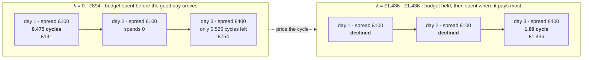

# The cycle budget

*The cycle budget constaraint couples distant windows.*

[← README](../README.md) · [data](data.md) · [architecture](architecture.md) ·
[solve](solve.md) · [bisection](bisection.md) ·
[cycle-value experiments](model/cycle-value-experiments.md) ·
[validation](validation.md) ·
[glossary](glossary.md)

---

§4.6 caps the horizon's total throughput: `n_cyc(T) ≤ 5,000` equivalent full
cycles. It is the only constraint in the formulation that couples periods
arbitrarily far apart, so it is the only one that an action today impacts the future. Therefore, we must find a way to bring this information forward to make the [the decomposition](solve.md) work.

## Without the lagrangian

Every window receives the cycles already spent in `BatteryState.cycles`,
accumulates from there, and caps the running total at the global budget. 

Nonetheless the budget could be spent at the start of the horizon, if no information is brought forward. A window cannot
see what a later window would have paid for a cycle, so the earliest days that
find any profitable spread consume the budget, and the best spreads in the
horizon arrive to find it gone. The plan is feasible and the cap respected,
and the answer is poor without anything flagging it.

## With the lagrangian: price the budget

Instead of assigning a budget per window, say 4.56 cycles a day, the budget is *valued* instead. A cycle value `λ` per equivalent full cycle enters each window's objective:

```python
# constraints.py: profit_objective, §3 with the cycle value of §6
problem += (
    pulp.lpSum(
        dt
        * (
            ctx.settlement.price_1[t] * (ctx.delivered * var.d1[t] - var.c1[t])
            + ctx.settlement.price_2[t] * (ctx.delivered * var.d2[t] - var.c2[t])
        )
        for t in ctx.periods
    )
    - ctx.cycle_value * cycles_used  # cycles_used = var.n_cyc[-1] - ctx.state.cycles
)
```

A window now spends a cycle only on a spread worth at least `λ`. It declines a
mediocre trade today because the cycle value prices in the possibility of a better
one later, without needing to know what that trade is.

The `λ` wanted is the budget's shadow price: **the cycle value at which the horizon
spends exactly its budget and no more**. Below it the early days overbuy; above
it cycles go unused that would have paid for themselves. Finding it is a search,
and every step of that search costs a whole pass over the horizon, so the method
is chosen on how many passes it spends and what it can say about the answer when
it stops. The default is **Kelley's cutting planes** on the dual of §6
([below](#kelleys-cutting-planes-the-default)). A budget that is not exhausted
at `λ = 0` is not binding, and zero is returned after a single pass.

A second method, a bisection on cycle use, is also implemented. It is **not** the
default and is kept for comparison — a second algorithm, on a different
subproblem, that the default can be checked against at horizons where no exact
solve is available. It has its own page: [bisection](bisection.md).

## What it looks like

The test instance of `tests/test_cycle_value.py`, with its real numbers: one cycle
of budget, three days, and the best spread deliberately placed beyond the
lookahead.



Both runs spend the full 1.0-cycle budget and both respect the cap. Only the
*allocation* differs: £894 becomes £1,436 for the same single cycle.

> [!NOTE]
> **A binding cap does not imply that a cycle value helps.** Valuing can only move
> cycles from a worse day to a better one, so on a horizon of identical days it
> changes nothing and profit comes out the same to the penny, correctly. λ is
> worth something only when the days differ **and** the better one sits beyond
> the lookahead, since a one-day lookahead already handles a next-day spread by
> itself. That is why the instance above is shaped the way it is.

## How λ is found

### Where a price comes from at all

The cap `n_cyc(T) ≤ B` is the one constraint that ties every window to every
other. Relax it into the objective with a multiplier and the coupling
disappears:

```
maximise   profit(x)  −  λ · ( n_cyc(T) − B )
         = [ per-window profit − λ · cycles spent in that window ] summed over windows  +  λB
```

For a *fixed* λ the bracketed term is separable: each window can be solved on
its own, because the only thing it needs to know about the rest of the horizon
is the price. **A global constraint has been traded for a per-window price.**
The `λB` term is a constant and changes no decision, so the code charges only
`cycle_value * cycles_used` and never adds the `λB` back.

λ is in **£ per equivalent full cycle** and acts as an opportunity cost: the
profit the horizon expects to forgo elsewhere if this window spends a cycle
here. A window then applies a rule that needs no knowledge of the future,
*take the trade only if the spread clears λ*. At the right λ that price equals
the marginal value of the last cycle in the budget, making it the budget's
shadow price. λ = 0 means cycles are free, so the budget is not binding.

### Kelley's cutting planes, the default

A *relaxed* pass — the model of §4 with `cycle_life_cap` dropped and the cycle value
in its place — returns more than one bit. It returns the value `L(λ)` of the
relaxed problem and an exact subgradient of it,

```
g = B − n_cyc(T)      evaluated at the pass's own plan
```

negative when the horizon overspends at this charge and positive when it
underspends. `L` is convex and piecewise linear in `λ`, being a pointwise
maximum of functions affine in `λ`, so each pass contributes a **cut**: a linear
function lying everywhere below `L`.

```
L(λ)  ≥  L(λ_i) + g_i · (λ − λ_i)       for every λ ≥ 0
```

The next charge to try is the minimiser of the cuts' upper envelope — a
two-variable linear program with one row per pass, which beside a pass over the
horizon costs nothing:

```
min  θ
s.t. θ ≥ L(λ_i) + g_i (λ − λ_i)     for each cut i
     0 ≤ λ ≤ upper_bound
```

```python
# cutting_plane.py: CuttingPlaneSearch.price, reduced to its loop
for _ in range(max_passes):                      # 20, a stop of last resort
    cuts.append(oracle.at(price, relaxed=True))  # value and subgradient
    best_dual = min(cut.value for cut in cuts)   # upper bound on min L
    envelope, next_cycle_value = solve_master(cuts, upper_bound)  # lower bound
    if best_dual - envelope <= tolerance * abs(best_dual):        # 1e-4
        break
    price = next_price

best = min(cuts, key=lambda cut: cut.value)
# Primal recovery: a relaxed pass is an evaluation, not a deliverable.
deliverable = best if best.feasible else oracle.at(best.price, relaxed=False)
```

Three things that follow, and they are the reason this is the default:

- **It brackets its own answer.** The best `L(λ_i)` evaluated so far is an upper
  bound on `min_λ L(λ)` and, by weak duality, on the constrained optimum itself;
  the master's value is a lower bound on the same quantity, the cuts being
  underestimators. So the loop stops on a **measured relative gap** rather than
  on an iteration count, and what it reports at exit is a statement about the
  quality of the answer rather than only about the price. `max_passes` is a stop
  of last resort; reaching it means the gap did not close, which the returned
  `DualBound` says.
- **It is cheaper.** Seven to nine passes across the 1-to-90-day sweep, a mean of
  8.4, against a fixed 13 for the bisection, and ten passes over the full three
  years. On the three-day instance it closes to a **zero** gap in 3 passes, which
  proves its £1,435.79 optimal for the relaxation.
- **Its λ is the shadow price, as stated.** £28.85 a cycle on 30 days of real
  prices, against an exactly solved £4,937.98 that it lands within 0.05% of.
  A bisection returns the top of a plateau instead, which yields the same
  plan but is not a price to quote.

One step is needed to turn the search into a deliverable. A relaxed pass may
overspend the budget, and an infeasible plan is not an answer, so the method
ends with **one capped pass at the value it settled on** — skipped when the best
relaxed pass already respects the budget, in which case its plan is already
feasible.

> [!WARNING]
> **What the bound is and is not.**
>
> **A near-zero duality gap is a property of these instances.** Lagrangian
> relaxation of a *mixed-integer* program generally leaves a gap, so
> `min_λ L(λ)` may exceed the constrained optimum strictly: the method stays
> correct, returning a plan and a valid bracket, but the bracket does not
> close. That eight instances closed to within 0.01% says something about this
> problem and nothing about the next one.
>
> **The bound rests on each pass being a true maximum.** Weak duality needs
> `L(λ)` maximised over the relaxed feasible set, and a rolling pass with one day
> of lookahead is a heuristic that can under-solve and report a value *below* the
> true `L`, which would leave the bound no bound at all. It is checked against an
> exact solve on eight horizons, 1 to 90 days; the three-year bound rests on the
> assumption rather than on evidence.
>
> **The gap is on the dual, not on the plan.** The dual gap holds at
> 0.003–0.007% on the long horizons while the distance from the bound to the
> *feasible* plan is 0.44% at a year and 1.72% over three years — £3,213. The
> recovery pass, not the search, is what that measures.
>
> Both are measured in
> [cycle-value experiments](model/cycle-value-experiments.md), where the two methods
> are also compared row by row against exactly solved instances.

## What this means for the actual answer

On the real three years with the full budget, **the cap is never reached:
3,443 of 5,000 cycles**. The round-trip loss of §4.2 needs 11% of spread before
a cycle breaks even, which rules out the narrow spreads long before cycle life
runs out. So `λ = 0`, no rationing happens, and the decomposition's only cost is
the foresight past its lookahead, which
[June 2018 puts at under 1%](solve.md#is-one-day-of-foresight-enough).

Under the pro-rated 1,500-cycle budget from §5
(`ModelParameters.prorated_cycle_budget()`) it binds, 3,443 unrationed use
against 1,500 available, and `λ` becomes active. What it is worth over the whole
three years is **not measured against a truth**: the run itself is cheap enough
— ten passes, 7 min 20 s with cutting planes — but nothing at that size can be
solved exactly to check it. It *is* checked on shorter instances with the budget
halved, against the exact answer. On 30 days of real prices the shadow
price is £28.85 a cycle and both methods land within 0.05% of an exactly solved
£4,937.98
([cycle-value experiments §2](model/cycle-value-experiments.md#2-what-each-method-costs-against-a-known-answer)).
