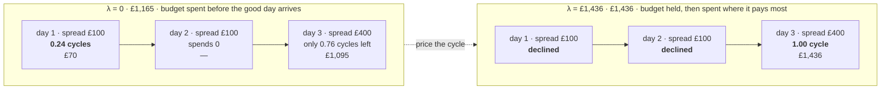
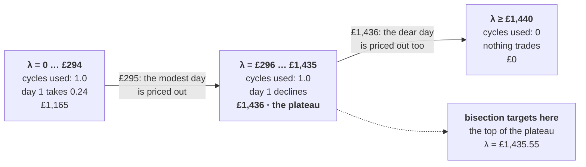

# The cycle budget

*A constraint that survives decomposition, and a calibration that didn't.*

[← README](../README.md) · [data](data.md) · [architecture](architecture.md) ·
[solve](solve.md) · [pricing experiments](model/cycle-price-experiments.md) ·
[validation](validation.md)

---

§4.6 caps the horizon's total throughput: `n_cyc(T) ≤ 5,000` equivalent full
cycles. It is the only constraint in the formulation that couples periods
arbitrarily far apart, so it is the only one [the decomposition](solve.md) can
get wrong. It did get it wrong, in the *opposite* direction to the obvious
guess.

## What each window enforces

Every window receives the cycles already spent in `BatteryState.cycles`,
accumulates from there, and caps the running total at the global budget. So the
budget **cannot be overspent**: the cap is enforced 1,096 times over, each time
against the true cumulative count. Feasibility was never the problem.

> [!WARNING]
> **The bug this exposed.** My first `calibrate_cycle_price` tested *"did the
> horizon use more cycles than the budget?"* and only then went looking for a
> price to ration them. The per-window cap makes overspend impossible, so that
> condition is **unreachable**: the calibration could never fire, and would have
> reported "nothing to do" on a horizon that was mis-spending its entire budget.
> A test caught it. It asserted the unpriced run exceeded the cap, and failed at
> 2.0 of 2.0 cycles rather than above it.

The real failure mode is **exhaustion rather than overspend**. A window cannot
see what a later window would have paid for a cycle, so the earliest days that
find any profitable spread consume the budget, and the best spreads in the
horizon arrive to find it gone. The schedule is feasible and the cap respected,
and the answer is poor without anything flagging it.

## The fix: price the budget instead of splitting it

Splitting the budget per window, say 4.56 cycles a day, would need to know in
advance which days deserve cycles, which is what the decomposition cannot
know. The budget is *priced* instead. A charge `λ` per equivalent full
cycle enters each window's objective:

```python
# constraints.py: profit_objective, §3 with the cycle charge of §6
problem += (
    pulp.lpSum(
        dt
        * (
            ctx.grid.price_1[t] * (ctx.delivered * var.d1[t] - var.c1[t])
            + ctx.grid.price_2[t] * (ctx.delivered * var.d2[t] - var.c2[t])
        )
        for t in ctx.periods
    )
    - ctx.cycle_price * cycles_used  # cycles_used = var.n_cyc[-1] - ctx.state.cycles
)
```

A window now spends a cycle only on a spread worth at least `λ`. It declines a
mediocre trade today because the charge prices in the possibility of a better
one later, without needing to know what that trade is.

The `λ` wanted is the budget's shadow price: **the largest charge at which the
horizon still spends its whole budget**. Below it the early days overbuy; above
it cycles go unused that would have paid for themselves. Cycle use falls
monotonically in `λ`, so `BisectionPricer` bisects, re-solving the horizon at
each step and keeping the highest price that still spends the budget in full. A
budget that is not exhausted at `λ = 0` is not binding, and zero is returned
after a single run.

This page is about that method, which the project started with and still uses by
default. A second one, Kelley's cutting planes on the dual of §6, now sits
beside it behind the same seam, costs about half the passes and returns a bound
on the answer. It is measured against this one in
[pricing experiments](model/cycle-price-experiments.md), and the seam is described in
[architecture §4](architecture.md#4-two-ways-to-price-the-cycle-budget).

## What it looks like

The regression test, with its real numbers: one cycle of budget, three days,
and the best spread deliberately placed beyond the lookahead.



Both runs spend the full 1.0-cycle budget and both respect the cap. Only the
*allocation* differs: £1,165 becomes £1,436 for the same single cycle.

> [!NOTE]
> **The subtlety that cost me a second test.** A binding cap does *not* imply a
> price helps. My first regression test used three identical days: the budget
> was exhausted early, pricing changed nothing, and profit was identical to the
> penny. That was correct: with identical days there is no misallocation to fix.
> The test only means something when the days differ **and** the better one
> sits beyond the lookahead, since a one-day lookahead already handles a
> next-day spread by itself.

## How λ is found: bisection on the price of a cycle

### Where a price comes from at all

The cap `n_cyc(T) ≤ B` is the one constraint that ties every window to every
other. Relax it into the objective with a multiplier and the coupling
disappears:

```
maximise   profit(x)  −  λ · ( n_cyc(T) − B )
         = [ per-window profit − λ · cycles spent in that window ] summed over windows  +  λB
```

For a *fixed* λ the bracketed term is separable: each window can be solved on
its own, because the only thing it needs to know about the rest of the horizon
is the price. **A global constraint has been traded for a per-window price.**
The `λB` term is a constant and changes no decision, so the code charges only
`cycle_price * cycles_used` and never adds the `λB` back.

λ is in **£ per equivalent full cycle** and acts as an opportunity cost: the
profit the horizon expects to forgo elsewhere if this window spends a cycle
here. A window then applies a rule that needs no knowledge of the future,
*take the trade only if the spread clears λ*. At the right λ that price equals
the marginal value of the last cycle in the budget, making it the budget's
shadow price. λ = 0 means cycles are free, so the budget is not binding.

### What the search is searching over

The obvious target, "find the λ where cycle use equals the budget", does not
exist in general. Cycle use as a function of λ is a **step function**: trades
drop out one threshold at a time, so the curve is flat almost everywhere and
jumps where a day stops being worth a cycle. Measured on the three-day test
case above, with one cycle of budget:

| λ (£/cycle) | Cycles used | Spent by day 1 | Gross profit | Regime |
| --- | --: | --: | --: | --- |
| 0 … 294 | 1.0000 | 0.2375 | £1,165.04 | budget spent in full, on the wrong days |
| 296 … 1,435 | 1.0000 | 0 | £1,435.79 | budget spent in full, on the best spread |
| 1,440 and up | 0.0000 | 0 | £0.00 | too dear to trade at all |



The two thresholds are the two days' marginal cycle values, and they are
visible to the pound: between £294 and £296 the modest day stops trading, and
between £1,435 and £1,440 the dear day does too. The middle column shows that
**cycle use alone cannot tell a good allocation from a bad one**, the budget
being spent in full on both sides of £295. What improves with λ is *where* it is
spent. The search therefore aims at the top of the plateau, the **highest λ at
which the budget is still fully spent**, which is the last λ before the most
valuable cycle in the horizon is itself priced out.

### The algorithm

```python
# bisection.py: BisectionPricer.price, reduced to its loop
# Probe at zero first: if the budget survives a free run, it does not bind.
best_schedule = run_whole_horizon(cycle_price=0.0)
if cycles_used(best_schedule) < budget * (1 - tolerance):
    return 0.0, best_schedule  # one pass, no bisection

low, high = 0.0, upper_bound  # invariant: low spends in full, high does not
for _ in range(max_iterations):  # 12
    price = 0.5 * (low + high)
    schedule = run_whole_horizon(cycle_price=price)  # 1,096 window MILPs
    if cycles_used(schedule) >= budget * (1 - tolerance):
        low = best_price = price  # still spends it all, so push the price up
        best_schedule = schedule  # keep it, so no pass is wasted
    else:
        high = price  # priced out cycles that would have paid
return best_price, best_schedule
```

Four details that matter more than the bisection itself:

- **Each iteration is a whole horizon**, a full rolling pass of 1,096 MILPs
  rather than a single window. The calibrated run therefore costs `1 + 12`
  passes, which puts the three-year calibration in hours rather than minutes.
  The pass is now `CycleOracle.at(λ, relaxed=False)`, which memoises and counts
  it, so a method cannot spend one twice unnoticed.
- **The schedule travels with the price.** Returning `(λ, schedule)` means the
  winning pass is kept rather than re-run at the end.
- **`tolerance` is a fraction of the budget, not of λ.** At `1e-3` a run counts
  as spending the budget if it gets within 0.1% of it. Some slack is necessary:
  the cycle count is a float out of a MILP solved to a feasibility tolerance,
  and the last fraction of a cycle is rarely spendable against the hourly
  blocks of §4.5.
- **The bracket does not need to be tight.** Twelve halvings leave an interval
  of `upper_bound / 2¹²`: about 5p at the default £200, £1.22 in the test's
  £5,000 range. Any λ inside the plateau yields the *same schedule*, so
  precision in λ is worth nothing beyond landing in the right band.

### The measured trace, iteration by iteration

| # | low | high | λ probed | Cycles | Gross profit | Verdict |
| --- | --: | --: | --: | --: | --: | --- |
| probe | — | — | 0.00 | 1.0000 | 1,165.04 | budget exhausted → it binds, bisect |
| 1 | 0.00 | 5,000.00 | 2,500.00 | 0.0000 | 0.00 | too dear |
| 2 | 0.00 | 2,500.00 | 1,250.00 | 1.0000 | 1,435.79 | keep |
| 3 | 1,250.00 | 2,500.00 | 1,875.00 | 0.0000 | 0.00 | too dear |
| 4 | 1,250.00 | 1,875.00 | 1,562.50 | 0.0000 | 0.00 | too dear |
| 5 | 1,250.00 | 1,562.50 | 1,406.25 | 1.0000 | 1,435.79 | keep |
| 6 | 1,406.25 | 1,562.50 | 1,484.38 | 0.0000 | 0.00 | too dear |
| 7 | 1,406.25 | 1,484.38 | 1,445.31 | 0.0000 | 0.00 | too dear |
| 8 | 1,406.25 | 1,445.31 | 1,425.78 | 1.0000 | 1,435.79 | keep |
| 9 | 1,425.78 | 1,445.31 | **1,435.55** | 1.0000 | 1,435.79 | **keep: the price returned** |
| 10 | 1,435.55 | 1,445.31 | 1,440.43 | 0.0000 | 0.00 | too dear |
| 11 | 1,435.55 | 1,440.43 | 1,437.99 | 0.0000 | 0.00 | too dear |
| 12 | 1,435.55 | 1,437.99 | 1,436.77 | 0.0000 | 0.00 | too dear |

The gross profit column carries the result: £1,165.04 free against £1,435.79
priced, for the same single cycle. It also shows the bisection working against a
step. Every "keep" after iteration 2 returns the identical schedule, so
iterations 5 to 12 buy nothing except confidence that £1,435.55 is the top of
the plateau, and every probe above the step returns 0 cycles and £0. The
bisection learns only "too dear", which is all it needs.

> [!WARNING]
> **What this method does not give you.**
>
> **It is not a proof of optimality.** Pricing a constraint instead of imposing
> it is a Lagrangian relaxation, and for a mixed-integer problem that carries a
> duality gap: there may be no λ whose per-window solutions assemble into the
> best budget-respecting schedule. λ rations the budget far better than
> first-come-first-served does, but it does not certify the result, and nothing
> in this method does: it reads one bit per pass and so has no dual value to
> report. `PricingResult.bound` is `None` for it, and
> [the cutting-plane method](model/cycle-price-experiments.md) exists for that
> reason.
>
> **Monotonicity is per window, not proven for the composition.** Within one
> window a higher charge can only reduce cycle use, from a fixed starting
> state. Across the horizon the handover changes that starting state, so total
> use is only *empirically* monotone in λ, which is what bisection assumes. It
> holds on this data as an assumption rather than a theorem.
>
> **The upper bound can clip silently.** If the budget is still fully spent at
> `upper_bound`, nothing notices: `low` walks up towards it and a price near the
> ceiling is returned as though it were the shadow price. The default £200 is
> well below the test case's £1,436, which is why that test has to pass
> `upper_bound=5_000`. A guard that re-probes at the ceiling before bisecting
> would fix it, and is not there yet.

## What this means for the actual answer

On the real three years with the full budget, **the cap is never reached:
3,443 of 5,000 cycles**. The round-trip loss of §4.2 needs 11% of spread before
a cycle breaks even, which rules out the narrow spreads long before cycle life
runs out. So `λ = 0`, no rationing happens, and the decomposition's only cost is
the foresight past its lookahead, which
[June 2018 puts at under 1%](solve.md#is-one-day-of-foresight-enough).

Under the pro-rated 1,500-cycle budget from §5
(`ModelParameters.prorated_cycle_budget()`) it binds, 3,443 unrationed use
against 1,500 available, and `λ` becomes active. What it is worth over the whole
three years is **not measured against a truth**: the run itself is cheap enough
— ten passes, 12 min 49 s with cutting planes — but nothing at that size can be
solved exactly to check it. It *is* checked on shorter instances with the budget
halved, against the exact answer. On 30 days of real prices the shadow
price is £28.85 a cycle and both methods land within 0.05% of an exactly solved
£4,937.98
([pricing experiments §2](model/cycle-price-experiments.md#2-what-each-method-costs-against-a-known-answer)).
