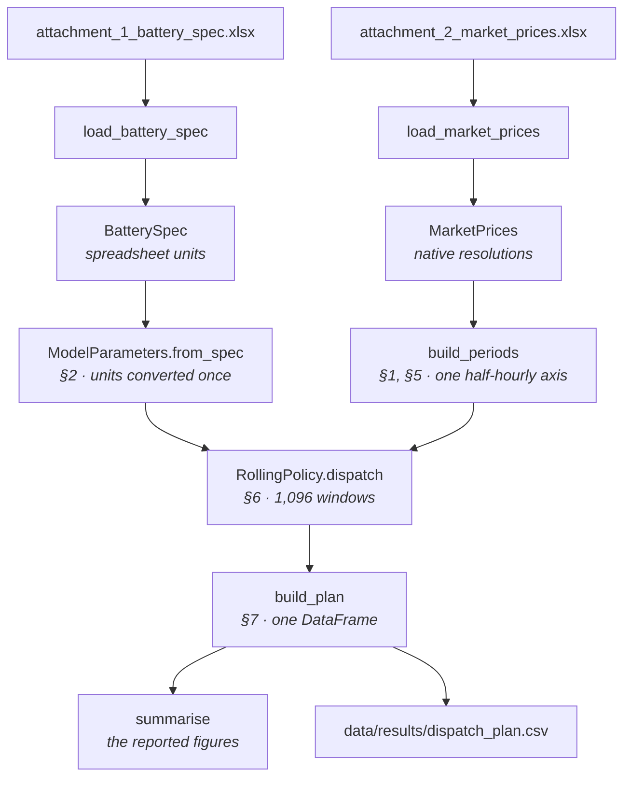
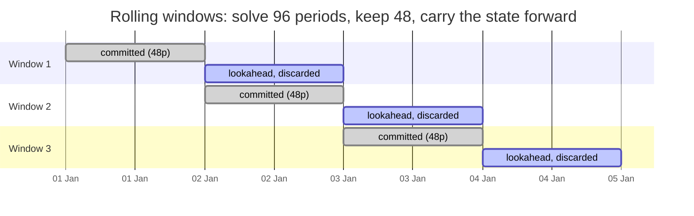
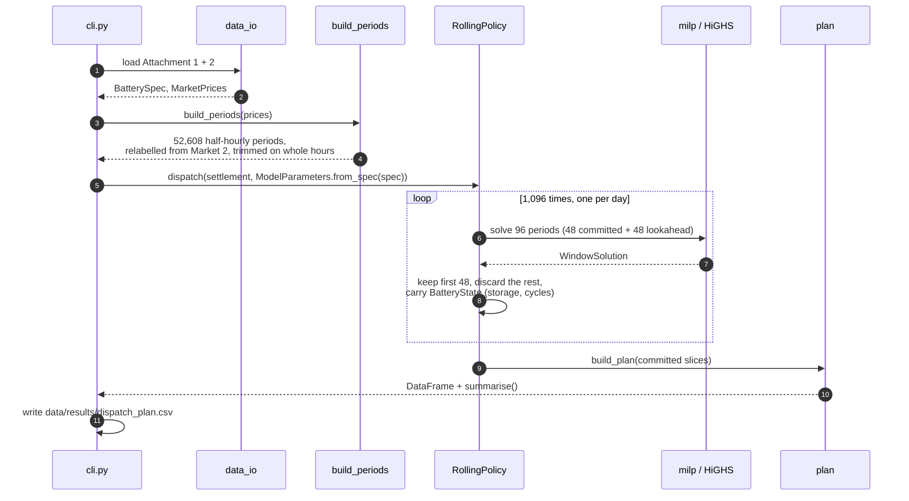

# What happens in a solve

*Why the horizon is decomposed, what one window does, and the evidence that a
day of foresight suffices.*

[← README](../README.md) · [data](data.md) · [architecture](architecture.md) ·
[cycle budget](cycle-budget.md) · [validation](validation.md) ·
[glossary](glossary.md)

---

## The pipeline

## Binary variables issue

`battery-case dispatch` over the full three years is **1,096 mixed-integer
programs**. The horizon carries a binary per period, the §4.3 exclusivity of
charging and discharging, and solve time grows steeply *and erratically* with
window length:

| Window | Solve time |
| --- | --- |
| 1 day (48 periods) | 0.04 s |
| 2 days | 0.2 s |
| 1 week | ~3 s |
| 1 fortnight | 5–17 s, depending which fortnight |

Running the whole horizon in one go is too heavy. The full measurements, including the whole horizon posed as one
program, are in [`model/tractability.md`](model/tractability.md).

## Decomposing the problem

Each window is solved with a day of foresight and committed for only half of
what it solved. The lookahead exists so that the committed day is not decided as
if the world ended at midnight. It is then thrown away.

Two numbers cross each boundary, carried in a `BatteryState`: the **state of
charge** and the **cumulative cycle count**. The handover carries both exactly,
so the decomposition stays feasible. Only the cycle *budget*, which couples
periods arbitrarily far apart, needed [special handling](cycle-budget.md).

Both lengths are tunable from the CLI (`--commit-days`, `--lookahead-days`) and
both must be a whole number of hours, so a Market 2 commitment is never split
across a boundary.

## End to end

One HiGHS instance is reused across every window. The full three years takes a
few minutes, with a progress line on stderr.

## Implementation details of the rolling loop

- Cost is linear in the horizon: 1,096 MILPs of fixed size (96 periods, 96
  binaries) rather than one of 52,608, whose difficulty grows faster than its
  length. One `HiGHS` solver object is built per pass and reused across every
  window.
- There are no warm starts. Consecutive windows differ only in their prices and
  their opening state, so each solve rebuilds a model much like the last one.
  This is the clearest remaining speed-up, and it is not implemented.
- The last window keeps what it has. `min(commit_periods, len(window))` commits
  the tail when the horizon does not divide evenly, and the final window has no
  lookahead to discard.
- Windows are whole hours by assertion. `__post_init__` rejects anything else,
  because an hourly Market 2 pair of §4.5 split across a boundary would let the
  two halves be committed to different prices.
- The handover is two floats. `state_after(committed)` reads *S* and *n_cyc* at
  the last committed period, the two quantities the next window's first-period
  constraints need.
- S_max is substituted rather than solved for. §4.7 lets the degraded capacity
  be folded into the storage bound (`storage[t] + volume * rho * n_cyc[t] <=
  volume`), which keeps 52,608 variables out of the full program.

## Is one day of foresight enough?

On this data, yes. June 2018:

| Configuration | Profit | Against the 1d + 1d baseline |
| --- | --: | --- |
| commit 1 day, **no** lookahead | | −0.7% |
| commit 1 day, 1 day lookahead | £4,621 | baseline |
| commit 1 week, 1 day lookahead | £4,621 | identical, to the penny |

Deciding each day completely blind to the next costs 0.7%, and committing a
whole week at a time earns *exactly* the same. The state of charge a 4 MWh store
can carry across midnight is worth at most two hours of discharge, so its
decisions do not reach far beyond the day they are taken in.

The caveat is we do not have a guarantee it will work on any problem.
